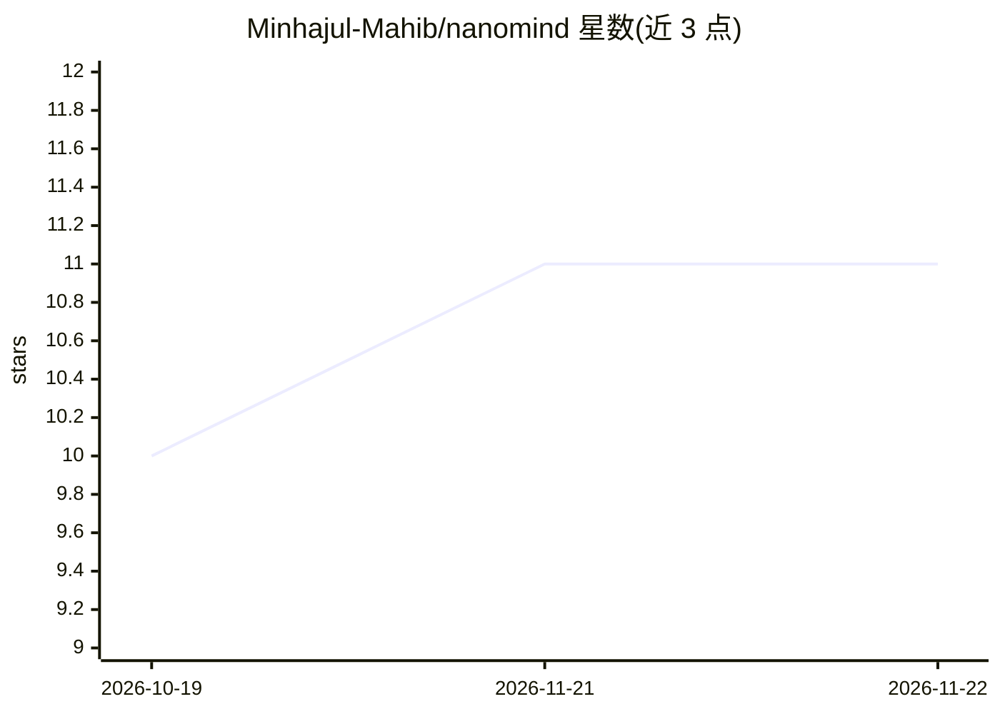

# Minhajul-Mahib/nanomind

⭐ 11 · Python · MIT · 推送 2026-04-23 · [GitHub](https://github.com/Minhajul-Mahib/nanomind) · [官网](https://nanomind.ink) · 个人维护

**低配设备（1GB RAM）上的离线本地 LLM 服务器，OpenAI 兼容 API**

面向低内存设备的本地 LLM 运行服务器：Python 实现的本机服务，启动后监听 8080 端口并提供 OpenAI 兼容 API 与文档页，任何以 OpenAI SDK 编写的客户端改 base_url 即可接入。安装器按设备可用 RAM 自动选择并下载对应模型（TinyLlama 1.1B 至 Mistral 7B 四档），全程离线运行。当前支持 Linux/Raspberry Pi、macOS、Windows，Android APK 尚未发布（规划于 v0.2）。

## 筛选速览

| 维度 | 判定 | 备注 |
|---|---|---|
| AI 角色 | `ai-ecosystem` | LLM/agent 周边工具 |
| 许可风险 | `permissive` | MIT |
| 部署形态 | `library` | 以包/库形式分发 |
| 模型依赖 | — | README 未给出锁定关系 |
| 硬件要求 | — | 无带数字的原话,不猜 |
| 安装摩擦 | `low` | 无编译、无系统依赖或容器化 |
| 成熟度 | — | 结构信号不足 |

## 能力要点

- 1GB RAM 最低运行要求，按 RAM 自动选型下载模型（4 档）
- 提供 OpenAI 兼容 API，本地 8080 端口 + /docs 文档页
- 完全离线运行，MIT 许可
- 支持 Linux/Raspberry Pi、macOS、Windows 三平台

## 适用场景

- 在旧笔记本或树莓派上跑本地离线 LLM
- 让现有 OpenAI SDK 应用改 base_url 接入本地模型
- 隐私敏感场景下无网络使用本地 AI

## 场景标签

`推理引擎` · 领域:训练与推理

## 证据(README 行号)

> L67: python server/server.py
> L76: # Works with ANY app built for OpenAI — just change the base_url
> L89: The installer detects your RAM automatically and picks the right model.

## 星数曲线

2026-10-19 10 → 2026-11-22 11（+1）

---
*卡片 v1 · prompt 1.4 · 生成 2026-11-20 · 置信度 high · 依据 README sha `614706210244` · [字段定义](../../DATASET.md)*
