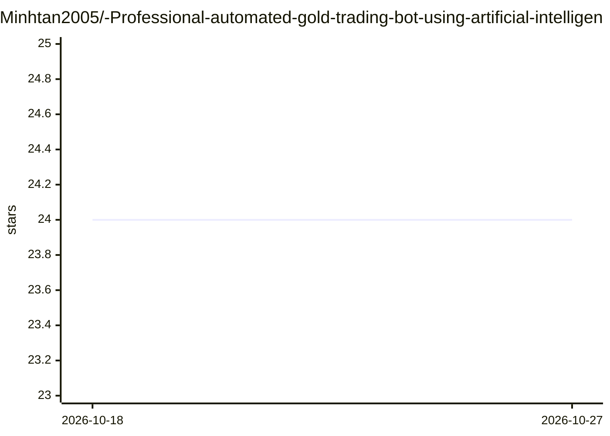

# Minhtan2005/-Professional-automated-gold-trading-bot-using-artificial-intelligence-for-MT5-XAUUSD-.

⭐ 24 · Python · 推送 2026-02-03 · [GitHub](https://github.com/Minhtan2005/-Professional-automated-gold-trading-bot-using-artificial-intelligence-for-MT5-XAUUSD-.) · 个人维护 · 中文 README

**面向 MT5 黄金交易的随机森林自动交易机器人（标准版）**

在 MetaTrader 5 平台对 XAUUSD（黄金）进行自动交易的 Python 机器人：启动后从 MT5 采集最近 1,000 根 M5 K 线，用 Random Forest 做本地训练以适配当前行情，随后进入观察阶段，待信号强度稳定后按模型置信度自动下单。需 Windows 10/11、Python 3.11 与已登录的 MetaTrader 5。标准版手数锁定 0.01，README 声明仅供教育/测试用途，不承担交易亏损责任。

## 筛选速览

| 维度 | 判定 | 备注 |
|---|---|---|
| AI 角色 | `ai-native` | 本体是模型或模型工具 |
| 许可风险 | `none` | — |
| 部署形态 | `library` | 以包/库形式分发 |
| 模型依赖 | — | README 未给出锁定关系 |
| 硬件要求 | — | 无带数字的原话,不猜 |
| 安装摩擦 | `low` | 无编译、无系统依赖或容器化 |
| 成熟度 | — | 结构信号不足 |

## 能力要点

- 采集 MT5 最近 1,000 根 M5 K 线并用 Random Forest 本地训练
- 信号强度稳定后按 AI 置信度自动执行交易
- 标准版手数锁定 0.01，另设 PRO 升级联系方式

## 适用场景

- 在 MT5 上对 XAUUSD 做模型驱动的自动交易测试
- 在学习/演示环境中观察随机森林行情预测流程

## 场景标签

`金融量化` · 领域:学习与行业

## 证据(README 行号)

> L2: AI Trading Bot for XAUUSD (Gold) on MT5.
> L41: It will then perform Local Training (Random Forest) to adapt to the current market trend.
> L53: Auto-Trading: Once the "Signal Strength" is stable, the bot will automatically execute trades based on its AI confi

## 星数曲线

2026-10-18 24 → 2026-10-27 24（+0）

---
*卡片 v1 · prompt 1.4 · 生成 2026-10-27 · 置信度 high · 依据 README sha `333a20237a02` · [字段定义](../../DATASET.md)*
