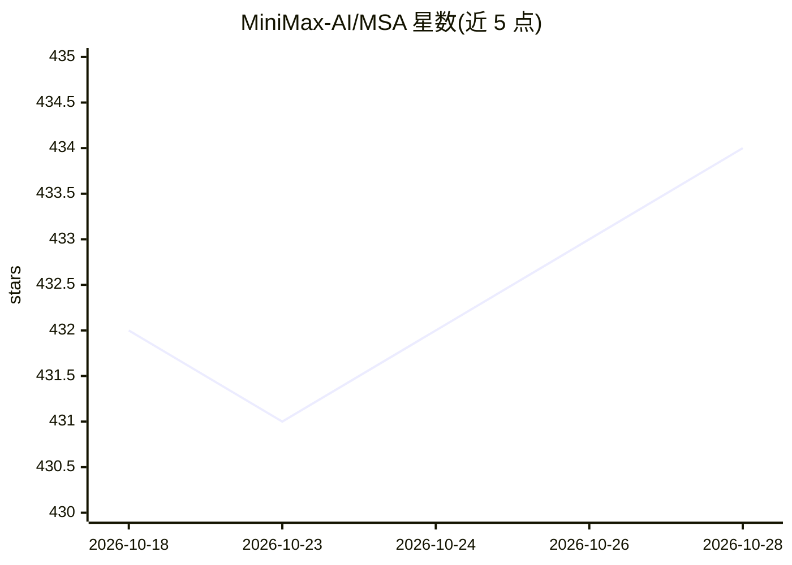

# MiniMax-AI/MSA

⭐ 434 · Python · MIT · 推送 2026-10-23 · [GitHub](https://github.com/MiniMax-AI/MSA) · 组织维护

**面向 NVIDIA SM100 的稠密/稀疏注意力 GPU 内核库**

MiniMax 开源的 CUDA 注意力内核 Python 包 fmha_sm100，包含两条 JIT 编译技术栈：csrc 栈提供稠密 FlashAttention 与 sparse_topk_select 索引器，CuTe-DSL 栈提供块稀疏 prefill、FP8/NVFP4/FP4 量化与分页 FP8 decode。要求 NVIDIA SM100 GPU、CUDA Toolkit（nvcc≥12.x）、Python≥3.10、Linux x86_64。首次导入时 JIT 编译，冷缓存需 30 秒至数分钟。供推理引擎与研究人员在 Blackwell 硬件上运行稀疏注意力。

## 筛选速览

| 维度 | 判定 | 备注 |
|---|---|---|
| AI 角色 | `ai-ecosystem` | LLM/agent 周边工具 |
| 许可风险 | `permissive` | MIT |
| 部署形态 | `library` | 以包/库形式分发 |
| 模型依赖 | — | README 未给出锁定关系 |
| 硬件要求 | — | 无带数字的原话,不猜 |
| 安装摩擦 | `high` | 编译与系统依赖俱全 |
| 成熟度 | — | 结构信号不足 |

## 能力要点

- 稠密 FlashAttention 与块稀疏注意力双栈，同一 Python 包
- 支持 BF16/FP8/NVFP4/FP4 量化与分页 FP8 decode
- csrc 内核首次导入时由 Jinja 模板 JIT 编译
- 通过 kernels 库可在 Hugging Face Hub 上获取

## 适用场景

- 在 NVIDIA SM100 GPU 上运行 MiniMax 稀疏注意力算法
- 为推理框架替换稠密 prefill 路径为块稀疏路径
- 对 FP8/NVFP4 注意力内核做基准测试

## 场景标签

`推理引擎` · 领域:训练与推理

## 证据(README 行号)

> L8: **MSA** (`fmha_sm100`) ships dense FlashAttention and sparse top-k attention
> L19: |**CuTe-DSL**|`python/fmha_sm100/cute/`|Full sparse attention (forward + paged FP8 decode, BF16 / FP8 / NVFP4 / FP4

## 星数曲线

2026-10-18 432 → 2026-10-28 434（+2）

---
*卡片 v1 · prompt 1.4 · 生成 2026-10-21 · 置信度 mid · 依据 README sha `216e1a0f94fa` · [字段定义](../../DATASET.md)*
