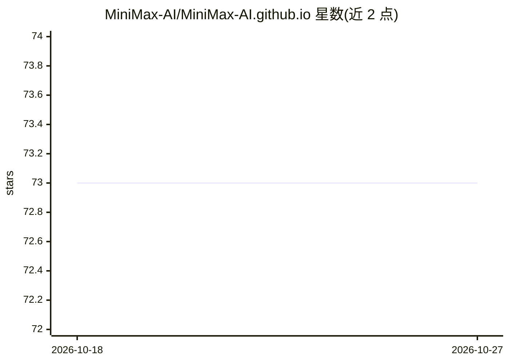

# MiniMax-AI/MiniMax-AI.github.io

⭐ 73 · HTML · 推送 2025-11-09 · [GitHub](https://github.com/MiniMax-AI/MiniMax-AI.github.io) · [官网](https://minimax-ai.github.io/tts_tech_report/) · 组织维护 · 中文 README

**MiniMax 官方 GitHub Page：论文与服务入口导航页**

MiniMax 公司的官方 GitHub Pages 仓库，README 仅做导航：列出 MiniMax-M1、SynLogic、MiniMax-01 等论文，以及官网、API 平台、Chat、Audio（TTS/语音克隆）、Hailuo 视频生成等产品入口与联系方式。仓库本身不含代码或安装内容，属于公司门户性质页面。

## 筛选速览

| 维度 | 判定 | 备注 |
|---|---|---|
| AI 角色 | `ai-knowledge` | 知识聚合/清单类 |
| 许可风险 | `none` | — |
| 部署形态 | `None` |  |
| 模型依赖 | — | README 未给出锁定关系 |
| 硬件要求 | — | 无带数字的原话,不猜 |
| 安装摩擦 | `low` | 无编译、无系统依赖或容器化 |
| 成熟度 | — | 结构信号不足 |

## 能力要点

- 列出 5 篇官方论文（M1/SynLogic/One-RL/语音技术报告/MiniMax-01）
- 汇总官网、API 平台、Chat、Audio、Hailuo 视频等产品入口

## 适用场景

- 查找 MiniMax 官方论文列表
- 跳转 MiniMax 各产品与 API 平台入口

## 场景标签

 · 领域:AI 公司门户/多模态模型与语音

## 证据(README 行号)

> L3: Welcome to the official GitHub Page for MiniMax.
> L7: Here are our latest papers:

## 星数曲线

2026-10-18 73 → 2026-10-27 73（+0）

---
*卡片 v1 · prompt 1.4 · 生成 2026-10-24 · 置信度 mid · 依据 README sha `9033a9f0e654` · [字段定义](../../DATASET.md)*
