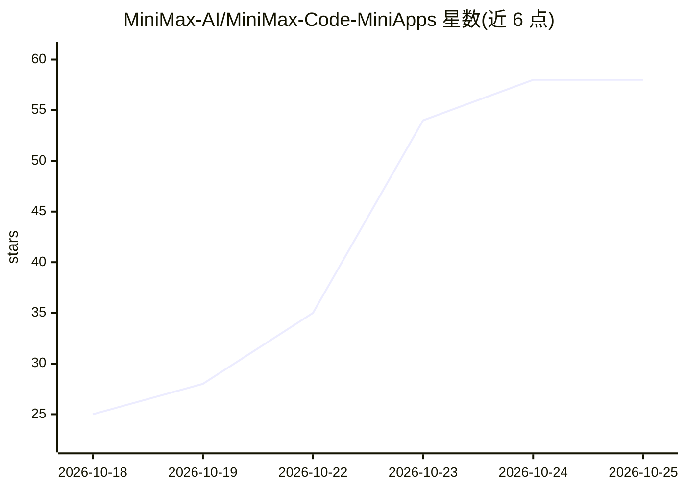

# MiniMax-AI/MiniMax-Code-MiniApps

⭐ 59 · JavaScript · MIT · 推送 2026-10-23 · [GitHub](https://github.com/MiniMax-AI/MiniMax-Code-MiniApps) · [官网](https://agent.minimax.io/docs/miniapp/overview) · 组织维护 · 中文 README

**MiniMax Code 桌面端 MiniApp 插件的官方社区仓库**

MiniMax-AI 维护的社区仓库，聚合为 MiniMax Code 桌面应用开发的 MiniApp 插件包：按作者目录 plugins/<github-username>/<plugin-id>/ 组织，含源码与使用说明，可下载后手动安装到 MiniMax Code。收录 20 个插件，覆盖 Token 用量监控、模型管理、CadQuery 3D 查看器、视频/图像编辑、Git 提交树等。README 阐述 Agent OS 与 Human-in-the-Loop 产品理念，并给出四层架构（宿主管理/Chromium 呈现/Node.js 应用层/能力与数据访问）。部分插件需 MiniMax Code 3.1.2 或更高版本。

## 筛选速览

| 维度 | 判定 | 备注 |
|---|---|---|
| AI 角色 | `ai-knowledge` | 知识聚合/清单类 |
| 许可风险 | `permissive` | MIT |
| 部署形态 | `None` |  |
| 模型依赖 | — | README 未给出锁定关系 |
| 硬件要求 | — | 无带数字的原话,不猜 |
| 安装摩擦 | `low` | 无编译、无系统依赖或容器化 |
| 成熟度 | — | 结构信号不足 |

## 能力要点

- 收录 20 个社区与官方 MiniApp 插件，含源码与使用说明
- 按作者目录组织，支持手动下载安装到 MiniMax Code
- 文档化四层插件架构与 Agent OS/Human-in-the-Loop 产品理念
- 部分插件需 MiniMax Code 3.1.2 或更高版本

## 适用场景

- 为 MiniMax Code 桌面端查找可安装的 MiniApp 插件
- 以现有插件源码为起点开发自己的 MiniApp
- 通过 PR 向社区提交自制插件

## 场景标签

`精选清单` · 领域:学习与行业

## 证据(README 行号)

> L5: The official community repository for **MiniApps built for the MiniMax Code desktop app**. Discover useful tools, pl
> L11: This repository is open to the community: anyone can contribute a MiniApp plugin by opening a pull request. MiniApp
> L13: Packages are organized by author under `plugins/<github-username>/<plugin-id>/`. You can download an app, install i

## 星数曲线

2026-10-18 25 → 2026-10-25 58（+33）

---
*卡片 v1 · prompt 1.4 · 生成 2026-10-24 · 置信度 high · 依据 README sha `a36ef57e5fb1` · [字段定义](../../DATASET.md)*
