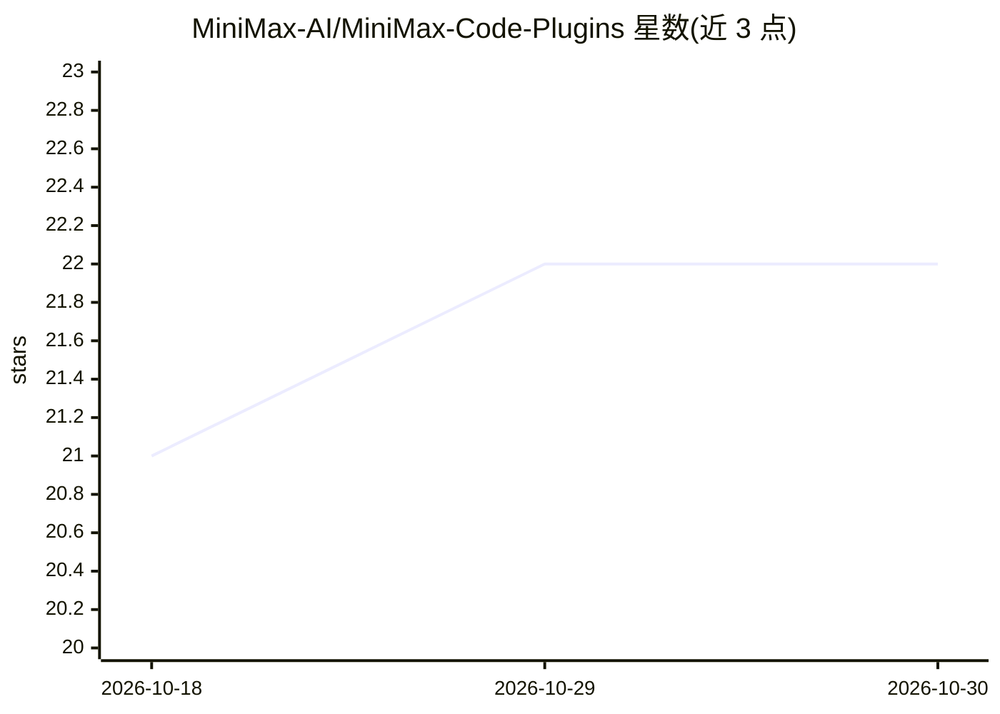

# MiniMax-AI/MiniMax-Code-Plugins

⭐ 22 · JavaScript · Apache-2.0 · 推送 2026-10-29 · [GitHub](https://github.com/MiniMax-AI/MiniMax-Code-Plugins) · 组织维护 · 中文 README

**MiniMax Code 的社区插件注册表与贡献工具链**

MiniMax-AI 维护的 Agent Plugins 社区仓库：开发者将可移植插件放入 plugins/<owner>/<name> 目录，通过一次 pull request 提交，CI 校验（npm run check）与人工审核通过后即可供用户安装。插件可包含 Skills（打包指令、工作流、领域知识）与 MCP server（stdio/streamable-http/sse），仓库提供 npm 脚手架（npm run create）生成模板。当前为 community preview 阶段，契约范围刻意收窄，Hooks、自定义 Agents、TUI Extensions 等暂不在插件能力内。

## 筛选速览

| 维度 | 判定 | 备注 |
|---|---|---|
| AI 角色 | `ai-ecosystem` | LLM/agent 周边工具 |
| 许可风险 | `permissive` | Apache-2.0 |
| 部署形态 | `library` | 以包/库形式分发 |
| 模型依赖 | — | README 未给出锁定关系 |
| 硬件要求 | — | 无带数字的原话,不猜 |
| 安装摩擦 | `low` | 无编译、无系统依赖或容器化 |
| 成熟度 | `idea` | |

## 能力要点

- 单目录+单 PR 的插件提交模式，无需独立仓库与 catalog JSON
- 插件可包含 Skills 与 MCP server（stdio/streamable-http/sse）
- npm 脚手架创建模板并通过 npm run check 校验
- 含安全模型、兼容性契约与治理文档

## 适用场景

- 为 MiniMax Code 开发并发布 Agent 插件
- 浏览社区插件源码并按需安装
- 学习插件契约与提交流程

## 场景标签

 · 领域:AI 编程工具/插件生态

## 证据(README 行号)

> L15: MiniMax Code Plugins is the community home for Agent Plugins that run in MiniMax Code. Put a
> L62: Connect MiniMax Code to local tools or remote services with `stdio`, `streamable-http`, or `sse`.

## 星数曲线

2026-10-18 21 → 2026-10-30 22（+1）

---
*卡片 v1 · prompt 1.4 · 生成 2026-10-28 · 置信度 high · 依据 README sha `3823cde3b3b9` · [字段定义](../../DATASET.md)*
