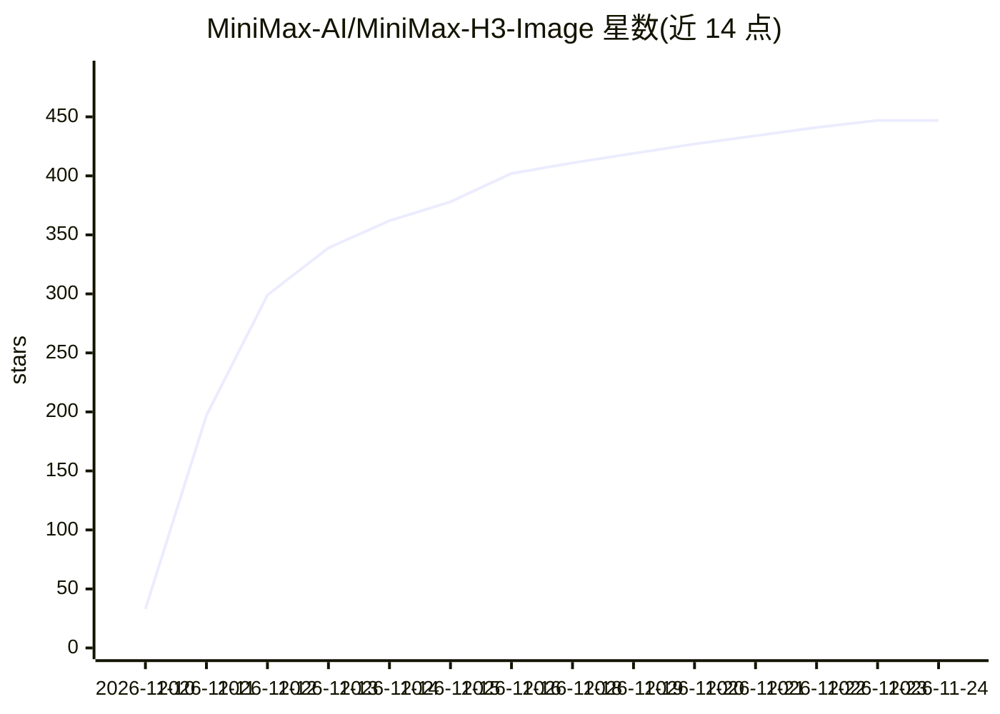

# MiniMax-AI/MiniMax-H3-Image

⭐ 447 · Python · NOASSERTION · 推送 2026-11-11 · [GitHub](https://github.com/MiniMax-AI/MiniMax-H3-Image) · 组织维护 · 中文 README

**开源权重图像生成与编辑模型，支持16MP文生图与多图编辑**

MiniMax 公司发布的开源权重图像模型，单一 checkpoint 同时支持文生图与多图编辑，直接生成约 16MP 图像（6 步采样，无需放大器），最多接受 16 张参考图，提示词最长 32,000 字符。模型为 33.1B 参数单流 diffusion transformer（BF16，DiT），使用 Qwen3-VL 文本编码器与图像 VAE，完整 checkpoint 约 204 GB，SGLang/vLLM-Omni 路径约 135 GB。可通过 SGLang、vLLM-Omni、diffusers、ComfyUI 本地部署，也可用 MiniMax API 在线使用。附带的 prompt-writing agent 技能可在 Claude Code、Codex、Cursor 等 agent 中调用并通过 API 渲染。

## 筛选速览

| 维度 | 判定 | 备注 |
|---|---|---|
| AI 角色 | `ai-native` | 本体是模型或模型工具 |
| 许可风险 | `none` | NOASSERTION |
| 部署形态 | `library` | 以包/库形式分发 |
| 模型依赖 | local-ok | 支持本地模型 |
| 硬件要求 | — | 无带数字的原话,不猜 |
| 安装摩擦 | `low` | 无编译、无系统依赖或容器化 |
| 成熟度 | — | 结构信号不足 |

## 能力要点

- 单一 checkpoint 同时支持文生图与多图编辑（最多16张参考图）
- 直接生成约 16MP 图像，6 步采样，无需放大器
- 33.1B 参数单流 DiT 架构，完整权重约 204 GB 公开下载
- 提供 SGLang / vLLM-Omni / diffusers / ComfyUI 四种部署方式

## 适用场景

- 本地部署开源文生图与图像编辑模型做内容生产
- 通过参考图做风格转换、图纸生成、多场景编辑
- 在 Claude Code 等 agent 中用技能辅助撰写提示词并渲染图像

## 场景标签

`图像生成` · 领域:内容生成

## 证据(README 行号)

> L156: MiniMax-H3-Image is a state-of-the-art open-source model for image generation and editing from the
> L160: - **16 MP at a practical cost.** It generates images of about 16 MP at every aspect ratio directly,
> L189: |**MiniMax-H3-Image**|Text-to-image and image editing|BF16 (DiT)|68.65 GB|MiniMaxAI/MiniMax-H3-Image|

## 星数曲线

2026-11-10 33 → 2026-11-24 447（+414）

---
*卡片 v1 · prompt 1.4 · 生成 2026-11-17 · 置信度 mid · 依据 README sha `822028208157` · [字段定义](../../DATASET.md)*
