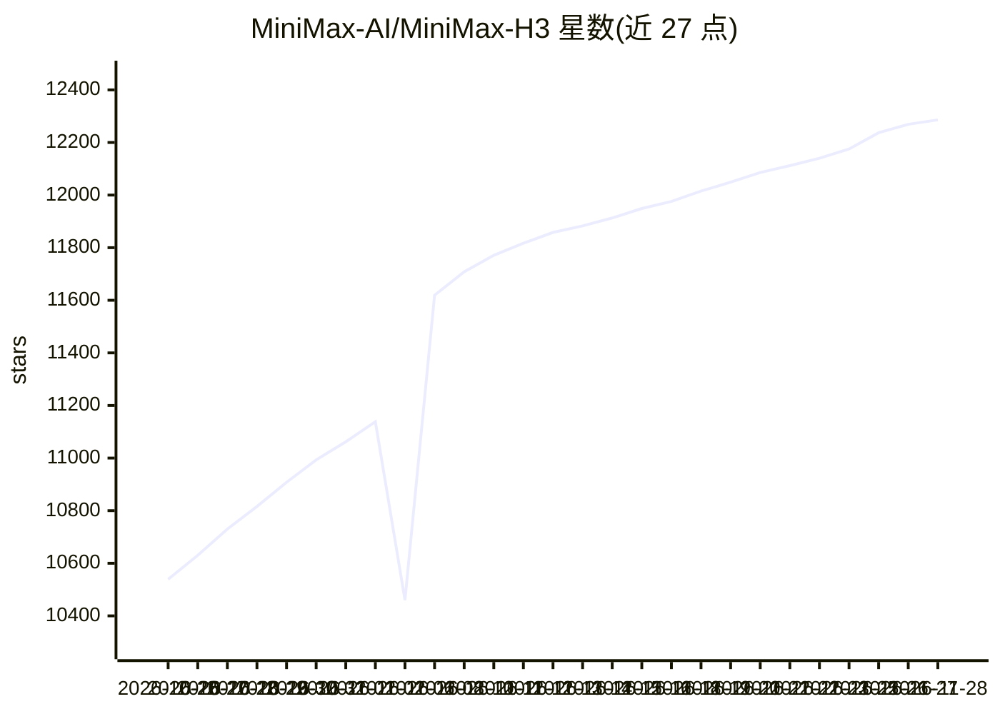

# MiniMax-AI/MiniMax-H3

⭐ 12,286 · Python · 推送 2026-10-28 · [GitHub](https://github.com/MiniMax-AI/MiniMax-H3) · 组织维护 · 中文 README

**MiniMax 的全模态视频生成模型，文/图/音生成带音频视频**

MiniMax H3 是一个全模态生成系统的开源模型发布仓库：开源 H3-Base（33B 单流 Transformer）权重，支持文本、图像、视频、音频的统一理解与视频生成（4–15 秒、768p、24FPS、32kHz 立体声，对话支持 11 种语言）。仓库附带 9 个 agent 技能，其中 h3-prompt-writing 为可移植的 Markdown 技能；H3-Context-IR 预处理与 2K 再生成模块未开源，仅提供 API 复现。架构基于 Qwen3-VL-32B 编码器与双 VAE，推理需加载官方分词器配置。

## 筛选速览

| 维度 | 判定 | 备注 |
|---|---|---|
| AI 角色 | `ai-native` | 本体是模型或模型工具 |
| 许可风险 | `none` | — |
| 部署形态 | `library` | 以包/库形式分发 |
| 模型依赖 | — | README 未给出锁定关系 |
| 硬件要求 | — | 无带数字的原话,不猜 |
| 安装摩擦 | `low` | 无编译、无系统依赖或容器化 |
| 成熟度 | `idea` | |

## 能力要点

- 开源 H3-Base 33B 模型权重，支持微调
- 多模态输入：≤9 图像、≤3 视频/音频片段，混合输入最多 12 个文件
- 输出 4–15 秒视频，带 32kHz 立体声，24FPS
- 提供 9 个 agent 技能，prompt 技能兼容多种 agent harness

## 适用场景

- 从文本/图像/参考视频生成分辨率 768p 的立体声视频
- 首尾帧或全参考模式驱动的视频生成
- 下载权重进行微调与自部署推理

## 场景标签

`视频生成` `多模态` `微调` · 领域:内容生成

## 证据(README 行号)

> L55: MiniMax H3 is a general-purpose, omni-modal generative system. It supports unified understanding of multimodal cont
> L79: - H3-Base: Generates audio and video based on the H3-Context-IR output, producing results at 768p resolution.
> L140: - For scalability and generalization, we adopt a relatively simple Transformer block design\. H3\-Omni\-Transforme

## 星数曲线

2026-10-26 10,539 → 2026-11-28 12,286（+1,747）

---
*卡片 v1 · prompt 1.4 · 生成 2026-11-22 · 置信度 high · 依据 README sha `779d33f52287` · [字段定义](../../DATASET.md)*
