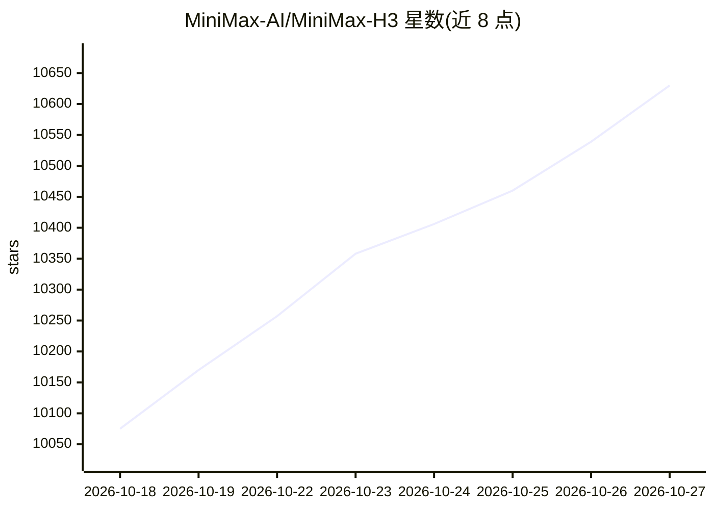

# MiniMax-AI/MiniMax-H3

⭐ 10,630 · Python · 推送 2026-08-15 · [GitHub](https://github.com/MiniMax-AI/MiniMax-H3) · 组织维护 · 中文 README

**全模态音视频生成系统 H3 的开源权重与技能包**

MiniMax 发布的通用全模态生成系统 H3 开源仓库：H3-Base（33B 参数 H3-Omni-Transformer）基于文本/图像/视频/音频输入生成带原生立体声的 4–15 秒视频，默认短边 768 像素、24 FPS。文本编码器复用 Qwen3-VL-32B 前层。H3-Context-IR 预处理系统与 H3-Regenerate-2K（2K 再生成模块）未随本次开源，仅提供 API 与教程。仓库另附 9 个 agent 技能（1 个可移植的提示词技能 + 8 个 MiniMax Hub 专用视频生成技能），可经 npx skills 安装。提供在线 API 与 App 入口。

## 筛选速览

| 维度 | 判定 | 备注 |
|---|---|---|
| AI 角色 | `ai-native` | 本体是模型或模型工具 |
| 许可风险 | `none` | — |
| 部署形态 | `library` | 以包/库形式分发 |
| 模型依赖 | local-ok | 支持本地模型 |
| 硬件要求 | — | 无带数字的原话,不猜 |
| 安装摩擦 | `low` | 无编译、无系统依赖或容器化 |
| 成熟度 | — | 结构信号不足 |

## 能力要点

- 文本/图像/视频/音频多模态输入，生成带原生立体声的视频（最长 15 秒）
- 开源 H3-Base 完整权重（33B，含可缓存的 AdaLN 分支），支持微调
- H3-Regenerate-2K 通过上下文再生成本体输出 2K 分辨率结果（模块未开源，提供 API）
- 9 个 agent 技能，其中 h3-prompt-writing 为纯 Markdown 可移植技能

## 适用场景

- 本地部署或微调 H3-Base 做音视频生成
- 通过 MiniMax API/App 直接调用 H3 生成视频
- 在 Claude Code/Cursor 等 agent 环境中使用 H3 提示词编写技能

## 场景标签

`视频生成` `多模态` `微调` · 领域:内容生成

## 证据(README 行号)

> L55: MiniMax H3 is a general-purpose, omni-modal generative system. It supports unified understanding of multimodal cont
> L78: - H3-Context-IR: As inputs become increasingly complex, we build a dedicated system to deeply understand and refine
> L140: - For scalability and generalization, we adopt a relatively simple Transformer block design\. H3\-Omni\-Transforme

## 星数曲线

2026-10-18 10,075 → 2026-10-27 10,630（+555）

---
*卡片 v1 · prompt 1.4 · 生成 2026-10-20 · 置信度 high · 依据 README sha `482fa713d68f` · [字段定义](../../DATASET.md)*
