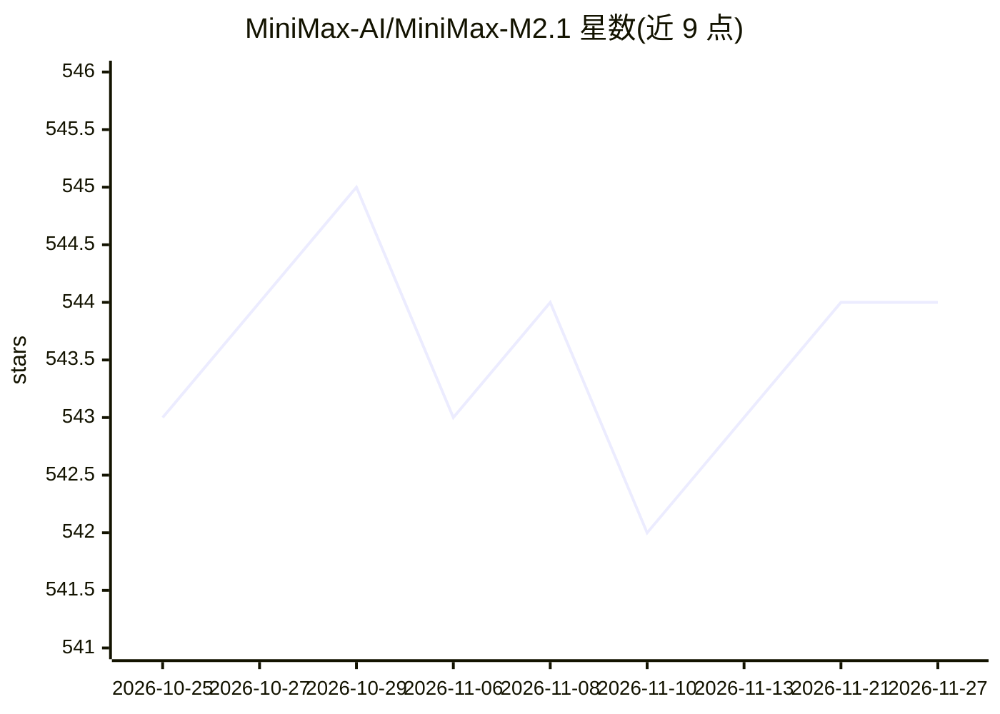

# MiniMax-AI/MiniMax-M2.1

⭐ 544 · NOASSERTION · 推送 2026-10-26 · [GitHub](https://github.com/MiniMax-AI/MiniMax-M2.1) · [官网](https://www.minimax.io) · 组织维护

**面向开发与 Agent 场景的开源大模型权重发布**

MiniMax 发布的 MiniMax-M2.1 开源模型：权重托管在 Hugging Face，可通过 SGLang、vLLM、Transformers、MLX-LM、KTransformers 等推理框架本地部署，也可通过官方开放平台 API 调用。定位为编码、工具调用、指令遵循与长程规划任务生成模型；README 给出 SWE-bench、VIBE 等多组基准评测数字、推荐推理参数（temperature=1.0, top_p=0.95, top_k=40）与工具调用指南链接。

## 筛选速览

| 维度 | 判定 | 备注 |
|---|---|---|
| AI 角色 | `ai-native` | 本体是模型或模型工具 |
| 许可风险 | `none` | NOASSERTION |
| 部署形态 | `None` |  |
| 模型依赖 | local-ok | 支持本地模型 |
| 硬件要求 | — | 无带数字的原话,不猜 |
| 安装摩擦 | `low` | 无编译、无系统依赖或容器化 |
| 成熟度 | — | 结构信号不足 |

## 能力要点

- 权重开源，支持本地部署与官方 API 两种获取方式
- 推荐 SGLang/vLLM/Transformers/MLX-LM/KTransformers 作为推理框架
- 给出推荐推理参数与默认系统提示词
- 提供工具调用指南与多组编码/Agent 基准评测数据

## 适用场景

- 本地部署用于代码生成与多语言软件工程任务
- 搭建需要多步工具调用的自动化 Agent 应用
- 通过 API 集成到办公自动化工作流中

## 场景标签

`代码生成` `编码 Agent` · 领域:编码与开发

## 证据(README 行号)

> L44: M2.1 was built to shatter the stereotype that high-performance agents must remain behind closed doors. We have opti
> L122: Download the model from HuggingFace repository: https://huggingface.co/MiniMaxAI/MiniMax-M2.1

## 星数曲线

2026-10-25 543 → 2026-11-27 544（+1）

---
*卡片 v1 · prompt 1.4 · 生成 2026-11-25 · 置信度 high · 依据 README sha `a592613cc4d1` · [字段定义](../../DATASET.md)*
