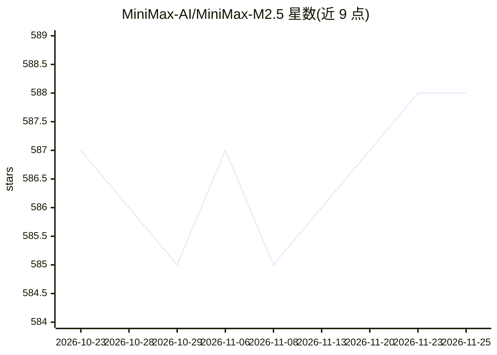

# MiniMax-AI/MiniMax-M2.5

⭐ 588 · NOASSERTION · 推送 2026-10-26 · [GitHub](https://github.com/MiniMax-AI/MiniMax-M2.5) · 组织维护

**MiniMax 面向编码与 Agent 任务的旗舰大模型发布说明**

MiniMax 发布的 M2.5 系列基础模型（含更快吞吐的 M2.5-Lightning 变体），定位编码、工具调用、搜索与办公场景，经大规模强化学习训练。README 介绍基准成绩、成本与速度数据、训练方法（自研 Forge RL 框架、CISPO 算法），并提供 API、Hugging Face、ModelScope 等获取渠道及 Modified-MIT 许可。面向需运行模型产出的开发者与 Agent 应用构建者，本文为模型公告页而非可运行代码仓库说明。

## 筛选速览

| 维度 | 判定 | 备注 |
|---|---|---|
| AI 角色 | `ai-native` | 本体是模型或模型工具 |
| 许可风险 | `none` | NOASSERTION |
| 部署形态 | `self-host` | docker 或自建部署 |
| 模型依赖 | — | README 未给出锁定关系 |
| 硬件要求 | — | 无带数字的原话,不猜 |
| 安装摩擦 | `low` | 无编译、无系统依赖或容器化 |
| 成熟度 | — | 结构信号不足 |

## 能力要点

- 提供 M2.5 与 M2.5-Lightning 两个速度不同的版本，均支持缓存
- 发布于 Hugging Face 与 ModelScope，许可为 Modified-MIT
- 自研 Forge agent-native RL 训练框架与 CISPO 算法
- 通过 MiniMax 平台 API 与 MiniMax Code 提供使用入口

## 适用场景

- 接入 API 在编码 Agent 场景中使用该模型
- 为需要工具调用与网页搜索的自动化任务选型模型
- 评估模型在办公文档产出场景的表现

## 场景标签

 · 领域:AI 模型/基础模型

## 证据(README 行号)

> L40: Today we're introducing our latest model, **MiniMax-M2.5**.
> L42: Extensively trained with reinforcement learning in hundreds of thousands of complex real-world environments, M2.5 i

## 星数曲线

2026-10-23 587 → 2026-11-25 588（+1）

---
*卡片 v1 · prompt 1.4 · 生成 2026-11-25 · 置信度 high · 依据 README sha `164650e7d4d2` · [字段定义](../../DATASET.md)*
