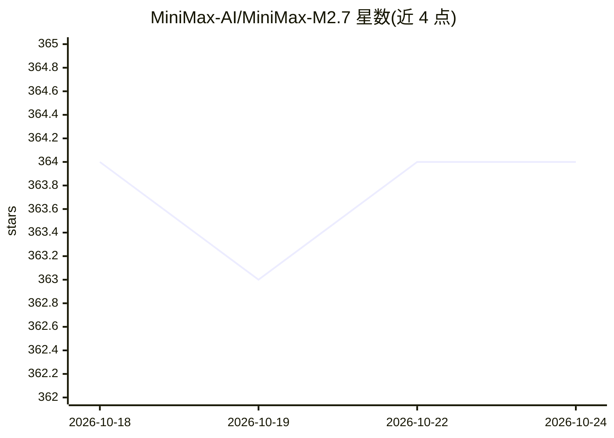

# MiniMax-AI/MiniMax-M2.7

⭐ 364 · NOASSERTION · 推送 2026-04-14 · [GitHub](https://github.com/MiniMax-AI/MiniMax-M2.7) · 组织维护 · 中文 README

**MiniMax 开源的 M2.7 大语言模型权重，面向 agent 与工程任务**

MiniMax 公司发布的开源权重大语言模型 M2.7，官方 README 描述其在开发过程中参与自身迭代（更新记忆、构建技能、优化学习流程），支持 Agent Teams 多智能体协作、动态工具搜索与 40+ 技能，覆盖软件工程（SWE 系列基准）、专业办公（Word/Excel/PPT 多轮编辑）与娱乐角色交互场景。提供 HuggingFace/ModelScope 权重下载，推荐 SGLang、vLLM、Transformers 部署，另有 MiniMax Agent/API/NVIDIA NIM 使用途径，并给出推荐推理参数与系统提示词。

## 筛选速览

| 维度 | 判定 | 备注 |
|---|---|---|
| AI 角色 | `ai-native` | 本体是模型或模型工具 |
| 许可风险 | `none` | NOASSERTION |
| 部署形态 | `None` |  |
| 模型依赖 | local-ok | 支持本地模型 |
| 硬件要求 | — | 无带数字的原话,不猜 |
| 安装摩擦 | `low` | 无编译、无系统依赖或容器化 |
| 成熟度 | — | 结构信号不足 |

## 能力要点

- 支持 Agent Teams 多智能体协作与动态工具搜索
- 在 SWE-Pro 56.22%、GDPval-AA ELO 1495 等基准有官方报告成绩
- 提供 SGLang / vLLM / Transformers 部署指南与推荐推理参数
- 附 Tool Calling 指南与 OpenRoom 交互演示（openroom.ai）

## 适用场景

- 本地部署开源权重大模型做代码生成与软件工程任务
- 构建多智能体协作与工具调用应用
- 通过 MiniMax API 或 Agent 平台直接调用该模型

## 场景标签

 · 领域:大模型/开源权重

## 证据(README 行号)

> L40: **MiniMax-M2.7** is our first model deeply participating in its own evolution. M2.7 is capable of building complex 
> L70: We recommend using the following inference frameworks (listed alphabetically) to serve the model:

## 星数曲线

2026-10-18 364 → 2026-10-24 364（+0）

---
*卡片 v1 · prompt 1.4 · 生成 2026-10-21 · 置信度 high · 依据 README sha `d2902f70aa35` · [字段定义](../../DATASET.md)*
