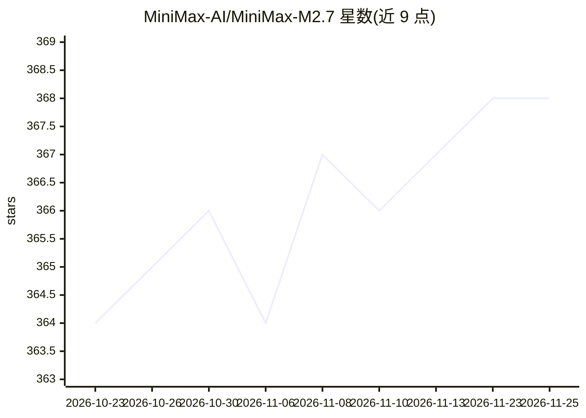

# MiniMax-AI/MiniMax-M2.7

⭐ 368 · NOASSERTION · 推送 2026-10-26 · [GitHub](https://github.com/MiniMax-AI/MiniMax-M2.7) · 组织维护

**MiniMax 开源的 Agent/编程任务大语言模型 M2.7**

MiniMax 发布的开源权重模型 M2.7，定位为构建 agent harness 与完成复杂生产力任务：官方介绍其支持 Agent Teams 多智能体协作、Skills 与动态工具搜索，应用于软件工程（日志分析、调试、重构、SRE 决策）、办公文档处理与角色互动娱乐场景。README 给出基准成绩、推荐推理参数（temperature/top_p/top_k）与默认系统提示词；本地部署需从 HuggingFace/ModelScope 下载权重，通过 SGLang、vLLM 或 Transformers 服务；也可经 MiniMax API、NVIDIA NIM Endpoint 使用。README 含官方自评基准对比表述。

## 筛选速览

| 维度 | 判定 | 备注 |
|---|---|---|
| AI 角色 | `ai-native` | 本体是模型或模型工具 |
| 许可风险 | `none` | NOASSERTION |
| 部署形态 | `None` |  |
| 模型依赖 | local-ok | 支持本地模型 |
| 硬件要求 | — | 无带数字的原话,不猜 |
| 安装摩擦 | `low` | 无编译、无系统依赖或容器化 |
| 成熟度 | — | 结构信号不足 |

## 能力要点

- 开源权重模型，可从 HuggingFace 与 ModelScope 下载
- 支持 Agent Teams 多智能体协作、Skills 与动态工具搜索
- 官方推荐 SGLang/vLLM/Transformers 三种本地推理框架
- 提供 Tool Calling 指南与推荐推理参数

## 适用场景

- 本地部署大模型跑编程与 agent 工作流
- 软件工程任务：调试、重构、日志与故障分析
- 通过 API 接入 MiniMax 模型做文本生成

## 场景标签

`编码 Agent` `多智能体` · 领域:Agent 开发

## 证据(README 行号)

> L40: **MiniMax-M2.7** is our first model deeply participating in its own evolution. M2.7 is capable of building complex 
> L68: Download the model from HuggingFace repository: https://huggingface.co/MiniMaxAI/MiniMax-M2.7
> L70: We recommend using the following inference frameworks (listed alphabetically) to serve the model:

## 星数曲线

2026-10-23 364 → 2026-11-25 368（+4）

---
*卡片 v1 · prompt 1.4 · 生成 2026-11-25 · 置信度 high · 依据 README sha `818b28a66ef1` · [字段定义](../../DATASET.md)*
