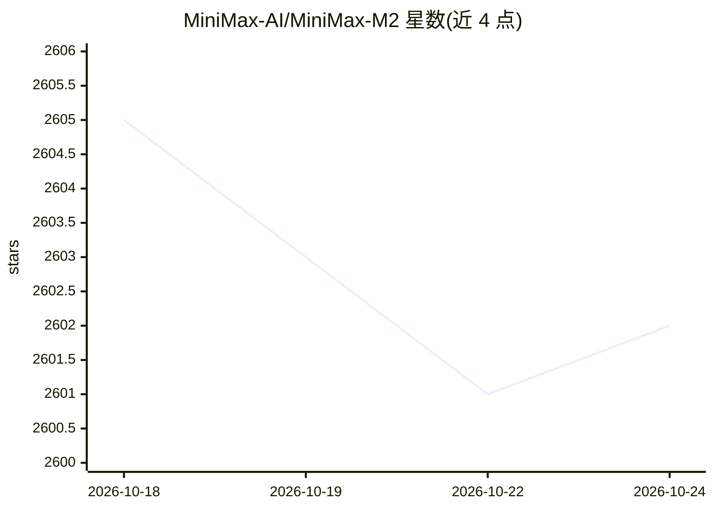

# MiniMax-AI/MiniMax-M2

⭐ 2,602 · NOASSERTION · 推送 2025-11-13 · [GitHub](https://github.com/MiniMax-AI/MiniMax-M2) · [官网](https://www.minimax.io/) · 组织维护 · 中文 README

**面向编码与 agent 工作流的开源 MoE 大模型权重（230B/10B 激活）**

MiniMax-M2 是 MiniMax 发布并开源的大语言模型权重仓库，总参数 230B、激活参数 10B，定位为编码与 agent 工作流场景。支持多文件编辑、shell/浏览器/检索/代码运行器等长链路工具调用，属交织思考（interleaved thinking）模型，输出含 <think> 标签且历史消息需保留该内容。README 给出 SWE-bench、Terminal-Bench、BrowseComp、AIME25、MMLU-Pro 等基准分数，并推荐 SGLang、vLLM、MLX 三个推理框架做本地部署，权重托管于 Hugging Face。

## 筛选速览

| 维度 | 判定 | 备注 |
|---|---|---|
| AI 角色 | `ai-native` | 本体是模型或模型工具 |
| 许可风险 | `permissive` | NOASSERTION |
| 部署形态 | `None` |  |
| 模型依赖 | local-ok | 支持本地模型 |
| 硬件要求 | — | 无带数字的原话,不猜 |
| 安装摩擦 | `low` | 无编译、无系统依赖或容器化 |
| 成熟度 | — | 结构信号不足 |

## 能力要点

- MoE 架构：230B 总参数 / 10B 激活参数
- 定位编码与 agent 场景：多文件编辑、终端、浏览器检索等工具链任务
- 交织思考模型：输出含 <think> 标签，历史消息需原样回传
- 推荐 SGLang / vLLM / MLX 三个推理框架本地部署

## 适用场景

- 通过 MiniMax 平台 API 或本地部署用于编码 agent 任务
- 搭建需要工具调用能力的长链路 agent 工作流
- 研究和评测开源大模型的编码与 agent 能力

## 场景标签

 · 领域:大模型/编码与Agent

## 证据(README 行号)

> L42: Today, we release and open source MiniMax-M2, a **Mini** model built for **Max** coding & agentic workflows.
> L131: - The MiniMax-M2 model weights are now **open-source**, allowing for local deployment and use: https://huggingface

## 星数曲线

2026-10-18 2,605 → 2026-10-24 2,602（-3）

---
*卡片 v1 · prompt 1.4 · 生成 2026-10-21 · 置信度 high · 依据 README sha `8eacb61fce22` · [字段定义](../../DATASET.md)*
