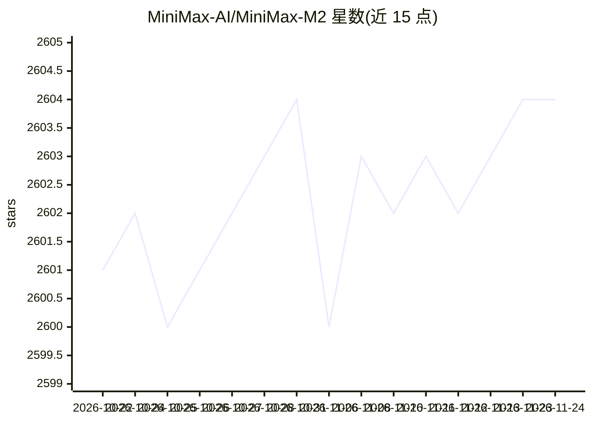

# MiniMax-AI/MiniMax-M2

⭐ 2,604 · NOASSERTION · 推送 2026-10-26 · [GitHub](https://github.com/MiniMax-AI/MiniMax-M2) · [官网](https://www.minimax.io/) · 组织维护

**开源 MoE 大模型权重，面向编码与 agent 工作流**

MiniMax 发布的开源模型权重仓库：230B 总参数、10B 激活参数的 MoE 模型，定位编码与 agentic 任务。README 给出基准评测结果（SWE-bench、Terminal-Bench、BrowseComp 等）、推荐推理参数（temperature=1.0 等），并说明 interleaved thinking 模型需在历史消息中保留 <think> 标签。权重开放于 Hugging Face 与 ModelScope，本地部署提供 SGLang、vLLM、MLX-LM 三个推理框架的部署指南；官方同时提供 MiniMax Code 产品与限时免费的 API 平台。MIT 许可。

## 筛选速览

| 维度 | 判定 | 备注 |
|---|---|---|
| AI 角色 | `ai-native` | 本体是模型或模型工具 |
| 许可风险 | `permissive` | NOASSERTION |
| 部署形态 | `None` |  |
| 模型依赖 | local-ok | 支持本地模型 |
| 硬件要求 | — | 无带数字的原话,不猜 |
| 安装摩擦 | `low` | 无编译、无系统依赖或容器化 |
| 成熟度 | — | 结构信号不足 |

## 能力要点

- MoE 架构：230B 总参数、10B 激活参数
- 提供 SGLang/vLLM/MLX-LM 三种本地部署途径
- 说明 interleaved thinking 输出格式须完整回传
- 提供官方推理参数建议与 Tool Calling 指南

## 适用场景

- 下载权重在本地推理框架中部署该模型
- 用作编码助手与 agent 工具链的底层模型
- 在 IDE、终端与 CI 场景中运行代码修复任务

## 场景标签

 · 领域:大语言模型

## 证据(README 行号)

> L42: Today, we release and open source MiniMax-M2, a **Mini** model built for **Max** coding & agentic workflows.
> L131: - The MiniMax-M2 model weights are now **open-source**, allowing for local deployment and use: https://huggingface
> L143: We recommend using vLLM to serve MiniMax-M2. vLLM provides efficient day-0 support of MiniMax-M2 model, check http

## 星数曲线

2026-10-22 2,601 → 2026-11-24 2,604（+3）

---
*卡片 v1 · prompt 1.4 · 生成 2026-11-23 · 置信度 high · 依据 README sha `775f7c86d338` · [字段定义](../../DATASET.md)*
