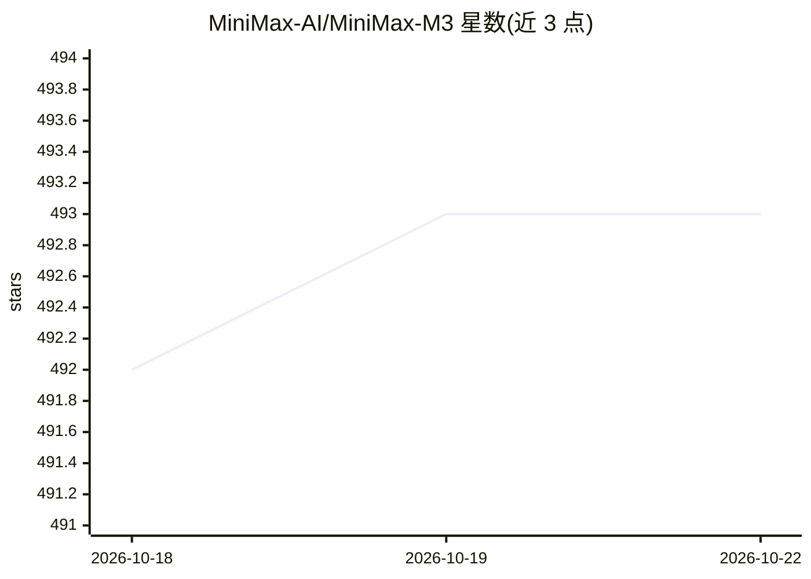

# MiniMax-AI/MiniMax-M3

⭐ 493 · 推送 2026-07-11 · [GitHub](https://github.com/MiniMax-AI/MiniMax-M3) · 组织维护 · 中文 README

**开源多模态基础模型：1M 上下文、约428B参数**

MiniMax-AI 发布的 MiniMax-M3 原生多模态模型，约 428B 总参数、约 23B 激活参数，支持 1M token 上下文。采用自首次训练起混合模态训练以融合文本、图像与视频语义；引入 MiniMax Sparse Attention（MSA）稀疏注意力算子提升长上下文效率，官方给出 1M 上下文下相对 M2 的 9× prefill 与 15× decode 加速数据。提供 enabled/adaptive/disabled 三种 thinking 推理模式，可通过 MiniMax Agent、API 或本地部署使用，推荐 SGLang、vLLM、Transformers、KTransformers、unsloth 等框架推理。

## 筛选速览

| 维度 | 判定 | 备注 |
|---|---|---|
| AI 角色 | `ai-native` | 本体是模型或模型工具 |
| 许可风险 | `none` | — |
| 部署形态 | `None` |  |
| 模型依赖 | local-ok | 支持本地模型 |
| 硬件要求 | — | 无带数字的原话,不猜 |
| 安装摩擦 | `low` | 无编译、无系统依赖或容器化 |
| 成熟度 | — | 结构信号不足 |

## 能力要点

- 原生多模态训练（文本/图像/视频），1M token 上下文
- MiniMax Sparse Attention（MSA）稀疏注意力，长上下文计算与显存开销降低
- thinking 参数支持 enabled/adaptive/disabled 三种推理模式
- 约 428B 参数、约 23B 激活参数

## 适用场景

- 通过 MiniMax API 或 Agent 直接调用多模态模型
- 本地下载权重用 vLLM/SGLang 等框架部署服务
- 长上下文的编码与 agent 协作任务

## 场景标签

`多模态` · 领域:感知与多模态

## 证据(README 行号)

> L17: MiniMax-M3 is a native multimodal model with 1M context. It has ~428B parameters and ~23B activated parameters.
> L20: - **Native Multimodality:** M3 undergoes mixed-modality training from the very first step, enabling deeper semantic

## 星数曲线

2026-10-18 492 → 2026-10-22 493（+1）

---
*卡片 v1 · prompt 1.4 · 生成 2026-10-21 · 置信度 high · 依据 README sha `deaca73d60ab` · [字段定义](../../DATASET.md)*
