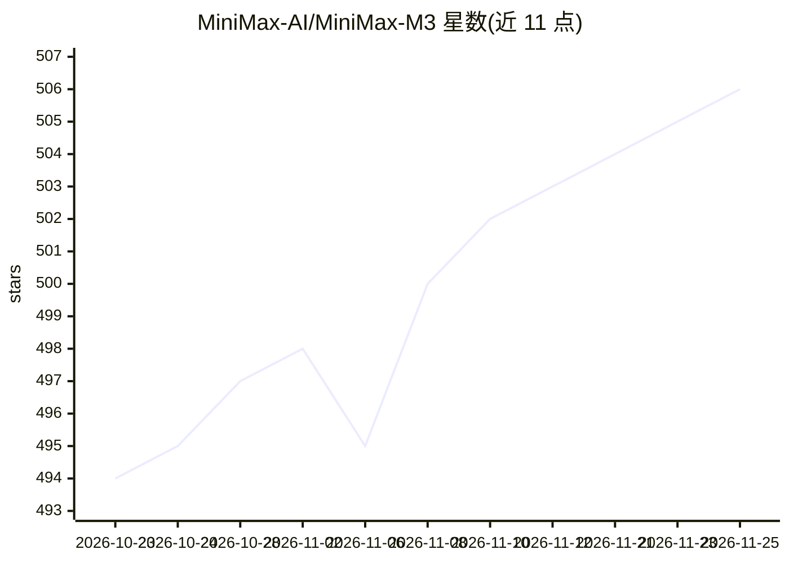

# MiniMax-AI/MiniMax-M3

⭐ 506 · 推送 2026-10-26 · [GitHub](https://github.com/MiniMax-AI/MiniMax-M3) · 组织维护 · 中文 README

**428B 参数原生多模态大模型：1M 上下文文本/图像/视频处理**

MiniMax 发布的旗舰开源模型：约 428B 总参数、23B 激活参数的原生多模态模型，支持 1M token 上下文与文本、图像、视频混合模态。核心机制是 MiniMax Sparse Attention（MSA）稀疏注意力算子，官方称在 1M 上下文下相较 M2 获得 9× prefill 与 15× decode 加速。提供 thinking 参数的三种推理模式（enabled/adaptive/disabled）。使用方式为 MiniMax Code/API 或本地部署，官方推荐 SGLang、vLLM、Transformers、KTransformers、unsloth 五种推理框架，并给出温度与 top_p 推荐参数。

## 筛选速览

| 维度 | 判定 | 备注 |
|---|---|---|
| AI 角色 | `ai-native` | 本体是模型或模型工具 |
| 许可风险 | `none` | — |
| 部署形态 | `None` |  |
| 模型依赖 | local-ok | 支持本地模型 |
| 硬件要求 | — | 无带数字的原话,不猜 |
| 安装摩擦 | `low` | 无编译、无系统依赖或容器化 |
| 成熟度 | — | 结构信号不足 |

## 能力要点

- 原生多模态训练：覆盖文本、图像、视频的深层语义融合
- MiniMax Sparse Attention 支撑 1M 上下文与长文本效率
- thinking 参数三档推理模式（enabled/adaptive/disabled）
- 官方提供 SGLang/vLLM/Transformers/KTransformers/unsloth 部署指引

## 适用场景

- 需要处理超长文档与百万级上下文的推理任务
- 多模态（文本/图像/视频）理解与生成场景
- 编码与长程 agent 协作任务
- 本地/自托管部署大模型推理服务

## 场景标签

`多模态` · 领域:感知与多模态

## 证据(README 行号)

> L17: MiniMax-M3 is a native multimodal model with 1M context. It has ~428B parameters and ~23B activated parameters.
> L21: - **Context Scaling via Sparse Attention:** M3 introduces MiniMax Sparse Attention (MSA) to improve long context ef

## 星数曲线

2026-10-23 494 → 2026-11-25 506（+12）

---
*卡片 v1 · prompt 1.4 · 生成 2026-11-25 · 置信度 high · 依据 README sha `98604af1776d` · [字段定义](../../DATASET.md)*
