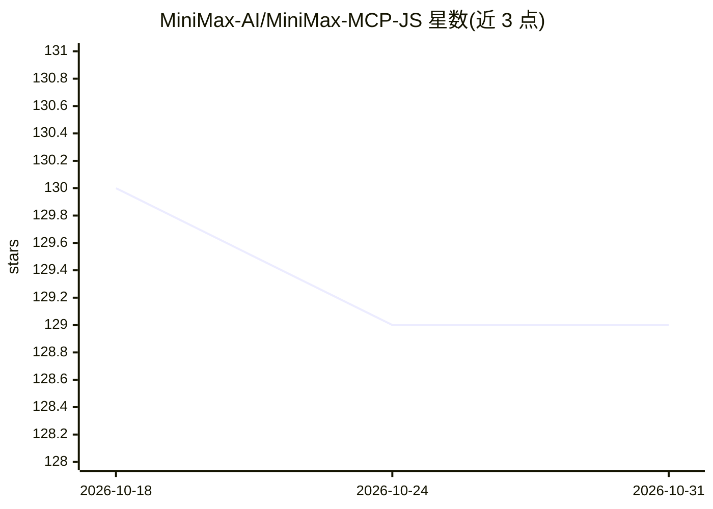

# MiniMax-AI/MiniMax-MCP-JS

⭐ 129 · TypeScript · MIT · 推送 2026-08-21 · [GitHub](https://github.com/MiniMax-AI/MiniMax-MCP-JS) · [官网](https://www.minimax.io/platform) · 组织维护 · 中文 README

**MiniMax 官方 MCP 服务器：图像/视频生成、TTS、语音克隆工具**

MiniMax-AI 官方维护的 Model Context Protocol JavaScript/TypeScript 实现，将 MiniMax 平台的文生图、文生视频（含 Hailuo-02）、文本转语音、语音克隆、声音设计等 API 封装为 MCP 工具，供 Claude Desktop、Cursor 等 MCP 兼容客户端调用。支持 stdio/REST/SSE 三种传输模式，配置可经请求参数、CLI 参数、环境变量等多级传入，区分国际版与中国大陆版 API host，兼容 ModelScope 等 MCP 平台托管。另提供官方 Python 版本实现。

## 筛选速览

| 维度 | 判定 | 备注 |
|---|---|---|
| AI 角色 | `ai-ecosystem` | LLM/agent 周边工具 |
| 许可风险 | `permissive` | MIT |
| 部署形态 | `library` | 以包/库形式分发 |
| 模型依赖 | — | README 未给出锁定关系 |
| 硬件要求 | — | 无带数字的原话,不猜 |
| 安装摩擦 | `low` | 无编译、无系统依赖或容器化 |
| 成熟度 | — | 结构信号不足 |

## 能力要点

- 封装 text_to_audio/voice_clone/text_to_image/generate_video/voice_design 等 MCP 工具
- 支持 stdio/REST/SSE 三种传输模式，可本地或云端部署
- 四级配置优先级（请求参数>CLI 参数>环境变量>配置文件），支持多租户
- 区分国际版与中国大陆版 API host，兼容 ModelScope 等 MCP 平台托管

## 适用场景

- 在 Claude Desktop 或 Cursor 中直接调用 MiniMax 的生图、生视频、TTS 能力
- 为 MCP 客户端接入语音克隆与声音设计工具
- 作为模块嵌入其他项目或通过平台托管多租户使用

## 场景标签

`图像生成` `语音合成` `视频生成` · 领域:内容生成

## 证据(README 行号)

> L5: JavaScript/TypeScript implementation of MiniMax MCP, providing image generation, video generation, text-to-speech, a
> L86: MiniMax MCP JS implements the Model Context Protocol (MCP) specification and can be used as a server to interact wi

## 星数曲线

2026-10-18 130 → 2026-10-31 129（-1）

---
*卡片 v1 · prompt 1.4 · 生成 2026-10-22 · 置信度 high · 依据 README sha `55e322a6783a` · [字段定义](../../DATASET.md)*
