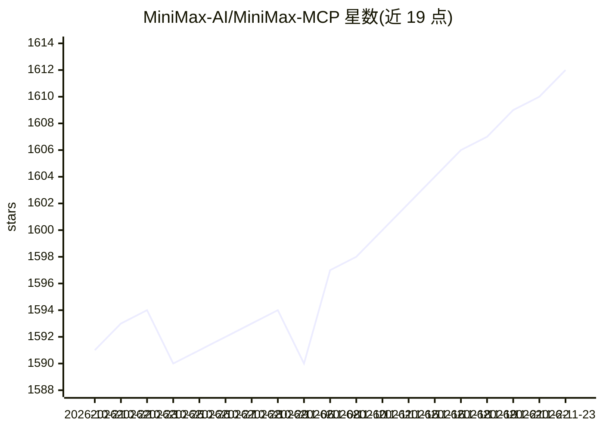

# MiniMax-AI/MiniMax-MCP

⭐ 1,612 · Python · MIT · 推送 2026-11-10 · [GitHub](https://github.com/MiniMax-AI/MiniMax-MCP) · [官网](https://www.minimax.io/platform) · 组织维护 · 中文 README

**MiniMax 官方 MCP 服务器：为 MCP 客户端接入语音/图像/视频生成 API**

MiniMax 官方的 Model Context Protocol 服务器，让 Claude Desktop、Cursor、Windsurf、OpenAI Agents 等 MCP 客户端通过工具调用访问 MiniMax API。提供 8 个工具：文本转语音、语音列表、声音克隆、声音设计、视频生成与任务查询、文生图（默认 MiniMax-H3-Image）与图像编辑。支持 stdio 与 SSE 两种传输方式，需配置与区域匹配的 API key 和 host，使用会产生 API 费用。

## 筛选速览

| 维度 | 判定 | 备注 |
|---|---|---|
| AI 角色 | `ai-ecosystem` | LLM/agent 周边工具 |
| 许可风险 | `permissive` | MIT |
| 部署形态 | `None` |  |
| 模型依赖 | — | README 未给出锁定关系 |
| 硬件要求 | — | 无带数字的原话,不猜 |
| 安装摩擦 | `low` | 无编译、无系统依赖或容器化 |
| 成熟度 | — | 结构信号不足 |

## 能力要点

- 8 个 MCP 工具：语音合成/克隆/设计、视频生成、文生图、图像编辑
- 支持 stdio 与 SSE 两种传输方式，可本地或云端部署
- 文生图默认 MiniMax-H3-Image，支持 1K/2K/4K area 与 size 参数
- 视频生成支持 MiniMax-Hailuo-02，6s/10s 时长与 768P/1080P 分辨率选项

## 适用场景

- 在 Claude Desktop/Cursor 中直接调用文本转语音与声音克隆
- 让 AI 客户端根据提示词生成图像并做参考图编辑
- 通过 MCP 工具异步提交和查询视频生成任务
- 播报类场景批量生成新闻口播音频

## 场景标签

`图像生成` `语音合成` `视频生成` · 领域:内容生成

## 证据(README 行号)

> L30:  Official MiniMax Model Context Protocol (MCP) server that enables interaction with powerful Text to Speech and vid
> L69: We support two transport types: stdio and sse.
> L76: ## Available Tools

## 星数曲线

2026-10-21 1,591 → 2026-11-23 1,612（+21）

---
*卡片 v1 · prompt 1.4 · 生成 2026-11-23 · 置信度 high · 依据 README sha `1dd064f15c0a` · [字段定义](../../DATASET.md)*
