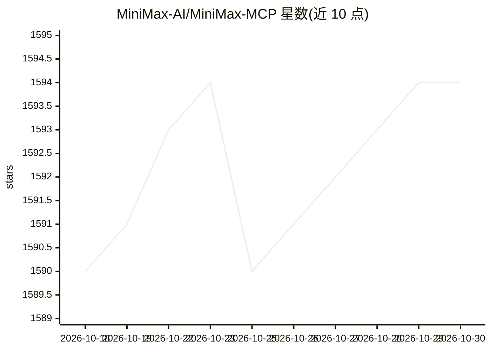

# MiniMax-AI/MiniMax-MCP

⭐ 1,594 · Python · MIT · 推送 2026-08-20 · [GitHub](https://github.com/MiniMax-AI/MiniMax-MCP) · [官网](https://www.minimax.io/platform) · 组织维护 · 中文 README

**MiniMax 官方 MCP 服务器：语音、图像与视频生成 API 接入**

MiniMax 官方维护的 Model Context Protocol 服务器，把 MiniMax 的文本转语音、语音克隆、语音设计、文生图与文生视频 API 暴露为 MCP 工具，供 Claude Desktop、Cursor、Windsurf、OpenAI Agents 等 MCP 客户端调用。通过 uv/uvx 安装运行，支持 stdio 与 SSE 两种传输方式；API key 与 host 需按 Global/中国内地区域匹配。使用工具可能产生 API 费用；README 推荐配合官方命令行工具 mmx-cli 使用。

## 筛选速览

| 维度 | 判定 | 备注 |
|---|---|---|
| AI 角色 | `ai-ecosystem` | LLM/agent 周边工具 |
| 许可风险 | `permissive` | MIT |
| 部署形态 | `None` |  |
| 模型依赖 | — | README 未给出锁定关系 |
| 硬件要求 | — | 无带数字的原话,不猜 |
| 安装摩擦 | `low` | 无编译、无系统依赖或容器化 |
| 成熟度 | — | 结构信号不足 |

## 能力要点

- text_to_audio / voice_clone / voice_design / generate_video / text_to_image 等 7 个 MCP 工具
- 支持 stdio 与 SSE 两种传输，SSE 可云端部署
- 按 Global 与中国内地区域区分 API host 与 key
- 支持 MiniMax-Hailuo-02 视频模型（6s/10s 时长、768P/1080P）

## 适用场景

- 在 Claude Desktop、Cursor 等 MCP 客户端里直接调用语音生成与克隆
- 通过对话式客户端生成图片和视频
- 云端部署 SSE 传输供团队使用

## 场景标签

`语音合成` `图像生成` `视频生成` · 领域:内容生成

## 证据(README 行号)

> L30:  Official MiniMax Model Context Protocol (MCP) server that enables interaction with powerful Text to Speech and vid
> L66: That's it. Your MCP client can now interact with MiniMax through these tools:
> L69: We support two transport types: stdio and sse.

## 星数曲线

2026-10-18 1,590 → 2026-10-30 1,594（+4）

---
*卡片 v1 · prompt 1.4 · 生成 2026-10-21 · 置信度 high · 依据 README sha `4d7747e40033` · [字段定义](../../DATASET.md)*
