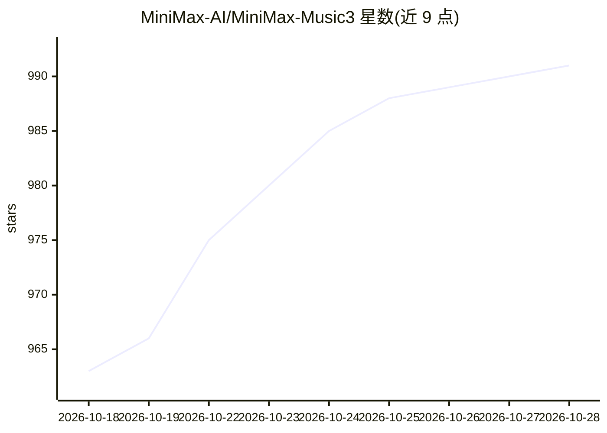

# MiniMax-AI/MiniMax-Music3

⭐ 995 · 推送 2026-10-26 · [GitHub](https://github.com/MiniMax-AI/MiniMax-Music3) · 组织维护 · 中文 README

**面向开发者的音乐生成模型：歌词+描述生成最长五分钟完整歌曲**

MiniMax 公司发布的音乐生成模型：以歌词和音乐描述为条件，生成含人声、编配演进的长达五分钟的完整歌曲，输出 32kHz 16-bit 立体声 WAV。架构采用 8B Global LLM（基于 Qwen3-8B 初始化）建模长程结构、0.6B Local LLM 处理帧级声学细节，结合 Flow Matching 与 Flow-VAE 的连续隐状态合成。附 music-caption-rewriter agent 技能用于扩写结构化提示词。推理需两块 CUDA GPU，经 SGLang-Omni 部署，仅支持非流式生成，文本提示上限 5000 token、9,000 声学帧。

## 筛选速览

| 维度 | 判定 | 备注 |
|---|---|---|
| AI 角色 | `ai-native` | 本体是模型或模型工具 |
| 许可风险 | `none` | — |
| 部署形态 | `library` | 以包/库形式分发 |
| 模型依赖 | — | README 未给出锁定关系 |
| 硬件要求 | — | 无带数字的原话,不猜 |
| 安装摩擦 | `medium` | 含编译或系统依赖之一 |
| 成熟度 | — | 结构信号不足 |

## 能力要点

- 生成长达五分钟的完整结构歌曲（含人声与段落编排）
- Hybrid-LM：8B Global LLM + 0.6B Local LLM 分层建模
- Flow Matching 与 Flow-VAE 连续隐状态融合合成
- music-caption-rewriter 技能将简述扩写为结构化 Caption

## 适用场景

- 输入歌词与音乐描述生成带人声的完整歌曲
- 通过段落标签与结构化 Caption 精细控制编曲走向
- 用 coding agent 调用 caption 技能改写音乐提示词

## 场景标签

 · 领域:音频生成/模型权重

## 证据(README 行号)

> L17: **MiniMax Music 3** is a high-performance music generation model for creating complete songs up to **five minutes**
> L19: MiniMax Music 3 combines an **8B Global LLM** for long-range musical structure, a **0.6B Local LLM** for frame-leve
> L100: sgl-omni serve --model-path MiniMaxAI/MiniMax-Music3 --port 8000

## 星数曲线

2026-10-18 963 → 2026-10-28 991（+28）

---
*卡片 v1 · prompt 1.4 · 生成 2026-10-21 · 置信度 mid · 依据 README sha `f8b1b6ca0bb9` · [字段定义](../../DATASET.md)*
