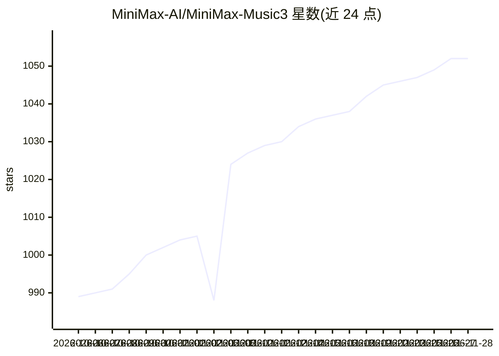

# MiniMax-AI/MiniMax-Music3

⭐ 1,052 · 推送 2026-10-26 · [GitHub](https://github.com/MiniMax-AI/MiniMax-Music3) · 组织维护 · 中文 README

**音乐生成模型：按歌词与描述生成长达5分钟完整歌曲**

MiniMax Music 3 是一个音乐生成模型，输入歌词与音乐描述，生成最长五分钟、结构完整（前奏/主歌/副歌/桥段等）的 32kHz 立体声 WAV 歌曲。采用 8B Global LLM 建模长程结构、0.6B Local LLM 建模帧级声学细节，结合 Flow Matching 与 Flow-VAE 隐状态合成；Global LLM 由 Qwen3-8B 初始化，tokenizer 使用 8 层 RVQ。通过 SGLang-Omni 部署服务，经共享 speech API 调用；另附 music-caption-rewriter agent skill 用于生成结构化描述。推理需两张 CUDA GPU，暂不支持流式生成。

## 筛选速览

| 维度 | 判定 | 备注 |
|---|---|---|
| AI 角色 | `ai-native` | 本体是模型或模型工具 |
| 许可风险 | `none` | — |
| 部署形态 | `library` | 以包/库形式分发 |
| 模型依赖 | — | README 未给出锁定关系 |
| 硬件要求 | — | 无带数字的原话,不猜 |
| 安装摩擦 | `medium` | 含编译或系统依赖之一 |
| 成熟度 | — | 结构信号不足 |

## 能力要点

- 原生支持最长五分钟的整曲生成，保持主题、节奏与人声一致性
- 歌词支持 [Verse]/[Chorus] 等段落标签控制，配合三段式结构化描述精细控制风格与人声/编曲
- Global LLM 基于 Qwen3-8B 初始化，分层自回归 + 隐状态融合合成
- 附 music-caption-rewriter agent skill，无外部 API 依赖

## 适用场景

- 根据自己写的歌词生成完整歌曲
- 用结构化描述控制曲风、BPM、调性与编曲演进
- 通过 speech API 批量生成配乐或歌曲

## 场景标签

 · 领域:音乐生成/音频生成

## 证据(README 行号)

> L17: **MiniMax Music 3** is a high-performance music generation model for creating complete songs up to **five minutes**
> L19: MiniMax Music 3 combines an **8B Global LLM** for long-range musical structure, a **0.6B Local LLM** for frame-leve
> L100: sgl-omni serve --model-path MiniMaxAI/MiniMax-Music3 --port 8000

## 星数曲线

2026-10-26 989 → 2026-11-28 1,052（+63）

---
*卡片 v1 · prompt 1.4 · 生成 2026-11-24 · 置信度 high · 依据 README sha `fcb14efc8c61` · [字段定义](../../DATASET.md)*
