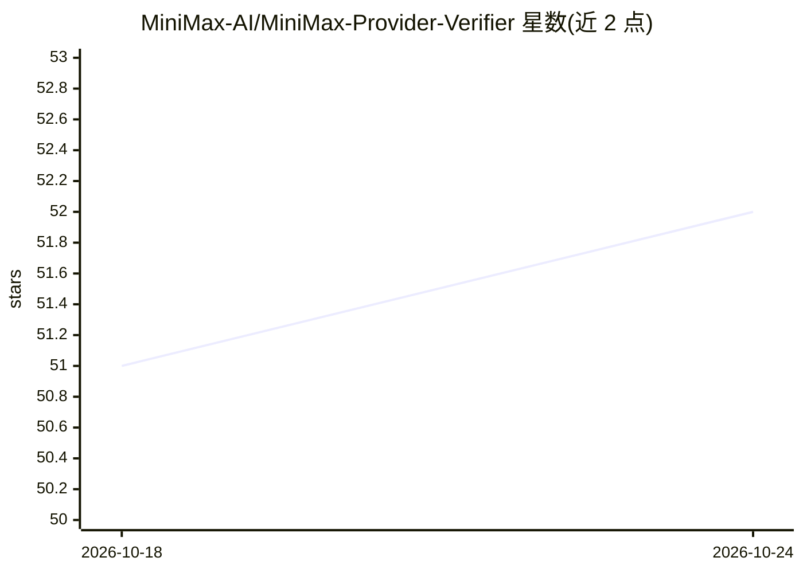

# MiniMax-AI/MiniMax-Provider-Verifier

⭐ 52 · Python · MIT · 推送 2026-10-23 · [GitHub](https://github.com/MiniMax-AI/MiniMax-Provider-Verifier) · 组织维护 · 中文 README

**验证 MiniMax M2 系模型第三方部署正确性的评测工具包**

MiniMax 官方提供的厂商无关验证工具包：针对 MiniMax M2 系列模型（M2 至 M3.1-Flash）的第三方部署，通过 JSONL 测试集并发发请求，计算查询成功率、工具调用匹配率、Schema 准确率、触发相似度（以官方部署为金标的 F1）、仅推理错误率、小语种遵循率与场景检查通过率等指标，并给出参考阈值判定部署是否正确稳定。verify.py 单次运行，另有 pass@10 批量脚本。README 附多家供应商（OpenRouter/vLLM/SGLang 等）的实测数据。

## 筛选速览

| 维度 | 判定 | 备注 |
|---|---|---|
| AI 角色 | `ai-ecosystem` | LLM/agent 周边工具 |
| 许可风险 | `permissive` | MIT |
| 部署形态 | `None` |  |
| 模型依赖 | — | README 未给出锁定关系 |
| 硬件要求 | — | 无带数字的原话,不猜 |
| 安装摩擦 | `low` | 无编译、无系统依赖或容器化 |
| 成熟度 | — | 结构信号不足 |

## 能力要点

- 7 项指标覆盖工具调用行为、Schema 正确性与系统稳定性
- 以官方 MiniMax 部署为金标计算触发相似度 F1
- 支持增量重跑（--incremental）与 pass@10 批量验证
- 提供各指标的参考阈值用于解读供应商表现

## 适用场景

- 上线前验证第三方推理服务商的 MiniMax 模型部署是否正确
- 对比多个供应商对同一模型的工具调用行为一致性
- 排查部署配置问题如 top-k 设置或 JSON 键重排序

## 场景标签

`模型评测` · 领域:评测与运维

## 证据(README 行号)

> L5: **MiniMax-Provider-Verifier** offers a rigorous, vendor-agnostic way to verify whether third-party deployments of th
> L9: We evaluate multiple dimensions of vendor deployments, including tool-calling behavior, schema correctness, and syst
> L141: `verify.py` runs the validation pipeline against a JSONL test set (each line is an entire request body), issues re

## 星数曲线

2026-10-18 51 → 2026-10-24 52（+1）

---
*卡片 v1 · prompt 1.4 · 生成 2026-10-24 · 置信度 high · 依据 README sha `18e974da0f83` · [字段定义](../../DATASET.md)*
