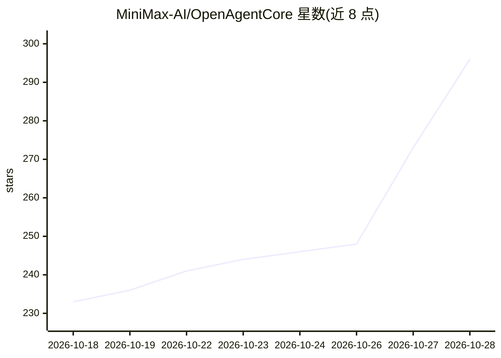

# MiniMax-AI/OpenAgentCore

⭐ 302 · Go · MIT · 推送 2026-10-28 · [GitHub](https://github.com/MiniMax-AI/OpenAgentCore) · [官网](https://openagentcore.dev/) · 组织维护 · 中文 README

**开源自托管版 OpenAI Agents API，用自有模型跑 Codex/Claude Code 等**

MiniMax 开源的自托管 agent 运行时：提供与 OpenAI Agents API 相同协议的 /v1 端点，应用程序将 OPENAI_BASE_URL 指向自部署实例后即可用官方 OpenAI SDK 调用。每个 Session 在沙箱内原生运行 Codex、Claude Code 或 MiniMax Code 等 Harness，模型提供商可自行配置。沙箱（microsandbox/E2B/Docker/本机 Linux/macOS/Windows）、工作区文件系统、Harness 与模型提供商均通过协议可替换。通过 Docker 与安装脚本部署 Core、Web 与 PostgreSQL。

## 筛选速览

| 维度 | 判定 | 备注 |
|---|---|---|
| AI 角色 | `ai-ecosystem` | LLM/agent 周边工具 |
| 许可风险 | `permissive` | MIT |
| 部署形态 | `None` |  |
| 模型依赖 | — | README 未给出锁定关系 |
| 硬件要求 | — | 无带数字的原话,不猜 |
| 安装摩擦 | `low` | 无编译、无系统依赖或容器化 |
| 成熟度 | — | 结构信号不足 |

## 能力要点

- 与 OpenAI Agents API 同协议，官方 OpenAI SDK 改 base URL 即可用
- Session 在沙箱中原生运行 Codex / Claude Code / MiniMax Code
- microsandbox 闲置释放算力、恢复时保留工作区文件
- 沙箱/文件系统/Harness/模型提供商均按协议可插拔

## 适用场景

- 在自己服务器上自托管兼容 OpenAI Agents API 的 agent 服务
- 通过 OpenAI SDK 调用自配模型的编码 agent
- 用 Docker 或 E2B 或本机作为沙箱运行 agent Session

## 场景标签

`编码 Agent` `Agent 框架` · 领域:Agent 开发

## 证据(README 行号)

> L3: The OpenAI Agents API, open source and self-hosted. Run Codex, Claude Code or MiniMax Code on your own machines with
> L11: - **Same API as OpenAI.** Set `OPENAI_BASE_URL` and the official OpenAI SDK, or plain HTTP, works unchanged.
> L53: |**Agents API**|`/v1`|Your applications. Same protocol as OpenAI's Agents API|

## 星数曲线

2026-10-18 233 → 2026-10-28 296（+63）

---
*卡片 v1 · prompt 1.4 · 生成 2026-10-22 · 置信度 high · 依据 README sha `3bfb66a141fa` · [字段定义](../../DATASET.md)*
