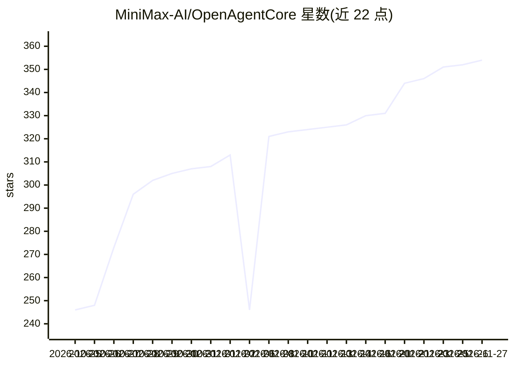

# MiniMax-AI/OpenAgentCore

⭐ 354 · Go · MIT · 推送 2026-11-19 · [GitHub](https://github.com/MiniMax-AI/OpenAgentCore) · [官网](https://openagentcore.dev/) · 组织维护 · 中文 README

**自托管的 OpenAI Agents API 兼容运行时，运行 Codex/Claude Code 等 coding agent**

提供与 OpenAI Agents API 相同协议的自托管服务：应用通过官方 OpenAI SDK 与 OPENAI_BASE_URL 接入，每个 Session 在沙箱环境中原生运行 Codex、Claude Code 或 MiniMax Code 等 Harness，模型提供者由用户配置。组件（沙箱提供者、工作区文件系统、Harness、模型提供者）通过定义的协议接入替换；空闲沙箱可释放计算并保留文件（microsandbox/E2B）。部署由 Core、Web 与 PostgreSQL 组成，提供 Linux/macOS/Windows 安装脚本，MIT 许可。

## 筛选速览

| 维度 | 判定 | 备注 |
|---|---|---|
| AI 角色 | `ai-ecosystem` | LLM/agent 周边工具 |
| 许可风险 | `permissive` | MIT |
| 部署形态 | `None` |  |
| 模型依赖 | — | README 未给出锁定关系 |
| 硬件要求 | — | 无带数字的原话,不猜 |
| 安装摩擦 | `low` | 无编译、无系统依赖或容器化 |
| 成熟度 | — | 结构信号不足 |

## 能力要点

- 与 OpenAI Agents API 相同协议，官方 OpenAI SDK 经 OPENAI_BASE_URL 即可接入
- Session 原生运行 Codex、Claude Code 或 MiniMax Code，模型提供者可配置
- 沙箱组件可替换（microsandbox、E2B 或自有 Linux/macOS/Windows 机器）
- 空闲沙箱释放计算、恢复时文件保留

## 适用场景

- 在自己的机器上用自有模型运行 coding agent
- 为应用提供 OpenAI Agents API 兼容的自托管后端
- 管理带持久工作区的 agent 沙箱会话

## 场景标签

`编码 Agent` · 领域:编码与开发

## 证据(README 行号)

> L3: The OpenAI Agents API, open source and self-hosted. Run Codex, Claude Code or MiniMax Code on your own machines with
> L13: - **Same API as OpenAI.** Set `OPENAI_BASE_URL` and the official OpenAI SDK, or plain HTTP, works unchanged.
> L16: - **Replaceable parts.** Sandbox Providers, workspace filesystems, Harnesses and model providers plug in through de

## 星数曲线

2026-10-25 246 → 2026-11-27 354（+108）

---
*卡片 v1 · prompt 1.4 · 生成 2026-11-25 · 置信度 high · 依据 README sha `fd4989e8831d` · [字段定义](../../DATASET.md)*
