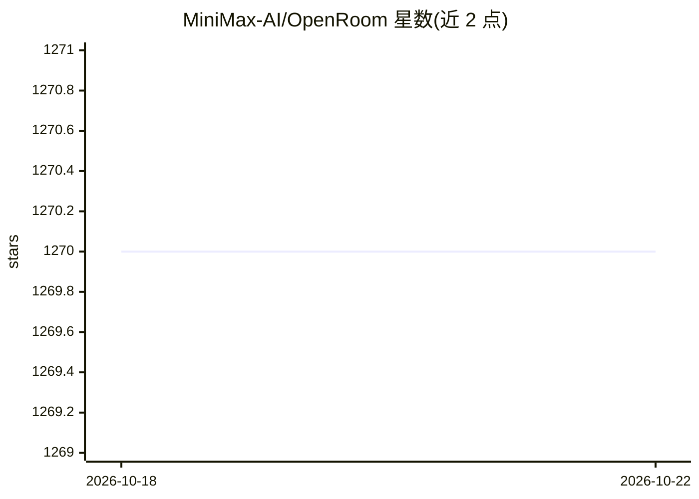

# MiniMax-AI/OpenRoom

⭐ 1,270 · TypeScript · MIT · 推送 2026-06-03 · [GitHub](https://github.com/MiniMax-AI/OpenRoom) · [官网](https://www.openroom.ai) · 组织维护 · 中文 README

**浏览器内桌面环境，AI Agent 用自然语言操作各应用**

在浏览器中提供类 macOS 桌面体验：可拖拽窗口、并排打开应用，内置音乐、国际象棋、日记、邮件等 9 个应用。核心是内置 AI Agent：通过结构化 Action 系统读取数据、触发操作、更新状态，可用自然语言操作任意应用；另提供 /vibe 命令在 Claude Code CLI 中经 6 阶段工作流用自然语言生成新应用并注册到桌面。数据存于 IndexedDB，本地运行无需后端；对话需配置 LLM API key。技术栈为 React 18 + TypeScript + Vite，pnpm monorepo。

## 筛选速览

| 维度 | 判定 | 备注 |
|---|---|---|
| AI 角色 | `ai-enhanced` | 去掉 AI 部分产品仍成立 |
| 许可风险 | `permissive` | MIT |
| 部署形态 | `library` | 以包/库形式分发 |
| 模型依赖 | — | README 未给出锁定关系 |
| 硬件要求 | — | 无带数字的原话,不猜 |
| 安装摩擦 | `low` | 无编译、无系统依赖或容器化 |
| 成熟度 | — | 结构信号不足 |

## 能力要点

- AI Agent 通过结构化 Action 系统操作全部内置应用
- /vibe 工作流经 6 阶段从描述生成完整新应用（Claude Code CLI）
- 9 个内置应用：音乐、国际象棋、五子棋、FreeCell、邮件、日记、Twitter、相册、新闻
- 数据存 IndexedDB，浏览器本地运行，无需后端与账户

## 适用场景

- 用自然语言指挥桌面上的应用播放音乐、写日记、开棋局
- 通过描述需求让 AI 生成新应用并集成到桌面
- 在浏览器中体验多窗口桌面与多个内置应用

## 场景标签

`GUI 自动化` `代码生成` · 领域:效率与自动化

## 证据(README 行号)

> L15: VibeApps brings a full desktop experience into your browser — windows you can drag and resize, apps you can open si
> L25: The Agent doesn't just launch apps — it **operates** them. It reads data, triggers actions, and updates state, all 

## 星数曲线

2026-10-18 1,270 → 2026-10-22 1,270（+0）

---
*卡片 v1 · prompt 1.4 · 生成 2026-10-21 · 置信度 mid · 依据 README sha `3703ed160340` · [字段定义](../../DATASET.md)*
