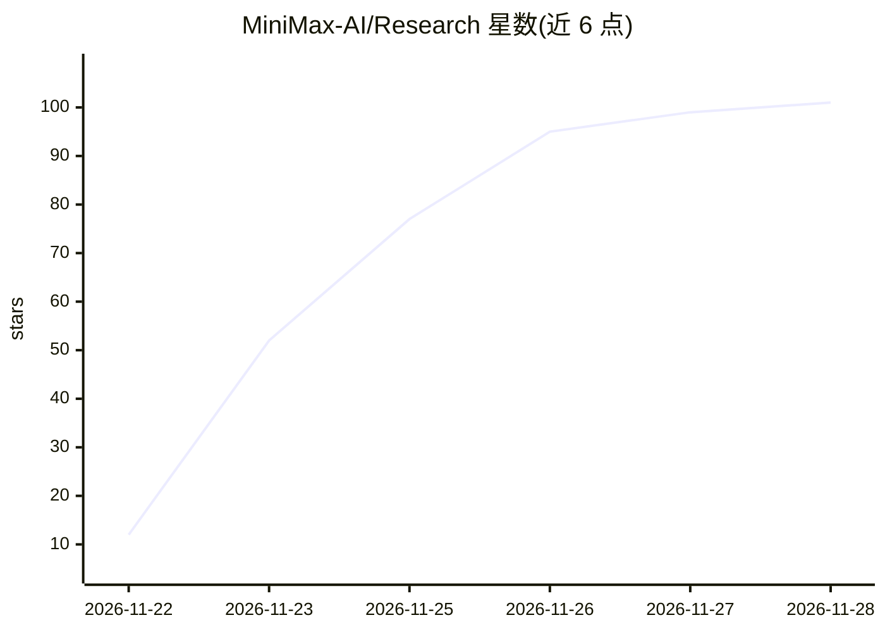

# MiniMax-AI/Research

⭐ 101 · TeX · NOASSERTION · 推送 2026-11-23 · [GitHub](https://github.com/MiniMax-AI/Research) · 组织维护

**MiniMax 发布内部模型产出的研究成果与论文**

MiniMax 用于发布其内部模型所产生研究成果的仓库，首个栏目为 Cryptography：收录自动密码分析项目的结果、论文与配套工件，涵盖对 COLM、TII McEliece、ARADI、HAWK、SBC-VOLE、Blender 等方案的密码分析条目，并附发布日期与团队联系邮箱。另一成果为对 Tokareva 弯函数猜想构造显式反例，证明以 Lean 4 形式化验证。仓库仅提供结果与工件链接，未包含统一安装或运行说明，整体采用 Apache 2.0 许可。

## 筛选速览

| 维度 | 判定 | 备注 |
|---|---|---|
| AI 角色 | `ai-knowledge` | 知识聚合/清单类 |
| 许可风险 | `none` | NOASSERTION |
| 部署形态 | `None` |  |
| 模型依赖 | — | README 未给出锁定关系 |
| 硬件要求 | — | 无带数字的原话,不猜 |
| 安装摩擦 | `low` | 无编译、无系统依赖或容器化 |
| 成熟度 | — | 结构信号不足 |

## 能力要点

- 收录内部模型发现的密码分析与密码学结果、论文及配套工件
- 条目覆盖 AEAD、后量子签名/KEM、分组密码、哈希函数等类别
- Tokareva 猜想反例的证明经 Lean 4 形式化验证
- 以 Apache 2.0 许可发布

## 适用场景

- 查看 MiniMax 内部模型在自动密码分析方向的产出结果
- 获取各密码方案攻击结果的论文与工件
- 研究布尔弯函数猜想的反例构造

## 场景标签

`科研工具` · 领域:学习与行业

## 证据(README 行号)

> L5: In this repository, we plan to share research projects and findings from MiniMax internal models.
> L9: The `Cryptography` directory contains results in cryptography and cryptanalysis, along with papers and supporting ar

## 星数曲线

2026-11-22 12 → 2026-11-28 101（+89）

---
*卡片 v1 · prompt 1.4 · 生成 2026-11-22 · 置信度 high · 依据 README sha `caaf06f72d14` · [字段定义](../../DATASET.md)*
