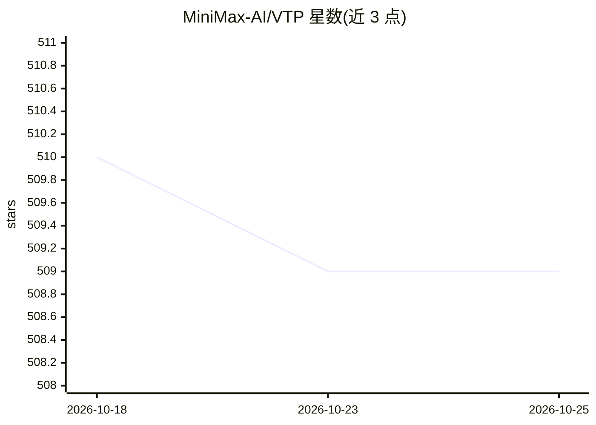

# MiniMax-AI/VTP

⭐ 509 · Python · NOASSERTION · 推送 2026-04-15 · [GitHub](https://github.com/MiniMax-AI/VTP) · [官网](https://huggingface.co/collections/MiniMaxAI/vtp) · 组织维护 · 中文 README

**面向生成的可扩展视觉分词器预训练框架（VTP）**

视觉分词器（visual tokenizer）统一预训练框架，联合优化图文对比、自监督与重建三类损失，用于训练 VTP-S/B/L 系列分词器并供扩散生成模型（DiT）使用。提供零样本分类、线性探针、重建与 ImageNet 生成四类评测脚本，生成评测基于 LightningDiT。标注为进行中工作，权重声明即将发布（S/B/L 检查点表中暂为空）。面向视觉生成与表征学习方向的研究者，论文为 arXiv:2512.13687。

## 筛选速览

| 维度 | 判定 | 备注 |
|---|---|---|
| AI 角色 | `ai-native` | 本体是模型或模型工具 |
| 许可风险 | `none` | NOASSERTION |
| 部署形态 | `library` | 以包/库形式分发 |
| 模型依赖 | — | README 未给出锁定关系 |
| 硬件要求 | — | 无带数字的原话,不猜 |
| 安装摩擦 | `low` | 无编译、无系统依赖或容器化 |
| 成熟度 | `idea` | |

## 能力要点

- 图文对比+自监督+重建三损失联合的视觉分词器预训练
- 提供 VTP-S/B/L 三个规模检查点（声明即将发布）
- 覆盖零样本分类、线性探针、重建、ImageNet 生成四类评测脚本

## 适用场景

- 研究视觉分词器预训练规模规律对生成质量的影响
- 为扩散生成模型训练提供带语义的 latent 表征
- 复现论文中的分类/重建/生成评测结果

## 场景标签

`模型训练` · 领域:训练与推理

## 证据(README 行号)

> L76: We present **VTP**, a unified visual tokenizer pre-training framework, pioneering the joint optimization of image-t
> L78: (1) Without modifying DiT training specs and FLOPs, solely scaling VTP pre-training consistently achieves gains in 
> L80: (3) Furthermore, the VTP-based diffusion model exhibits exceptionally fast convergence---reaching 2.03 gFID in only

## 星数曲线

2026-10-18 510 → 2026-10-25 509（-1）

---
*卡片 v1 · prompt 1.4 · 生成 2026-10-21 · 置信度 high · 依据 README sha `431be431e153` · [字段定义](../../DATASET.md)*
