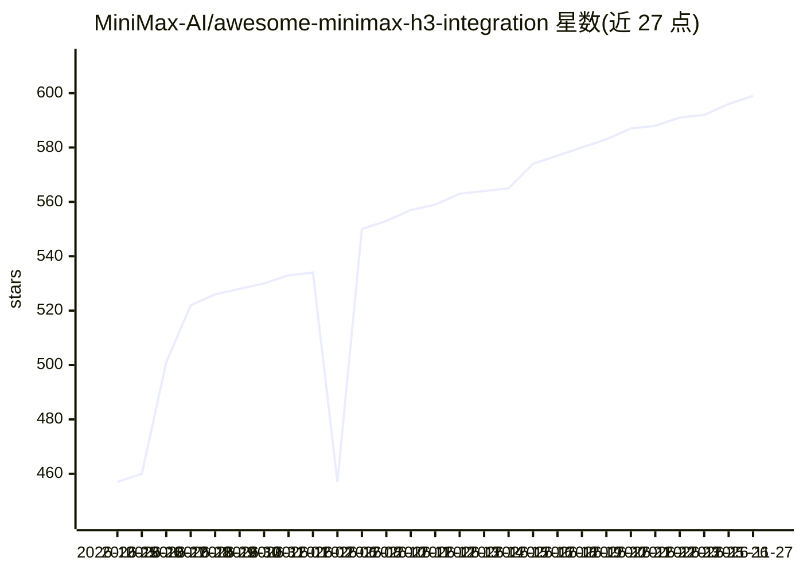

# MiniMax-AI/awesome-minimax-h3-integration

⭐ 599 · Python · 推送 2026-11-12 · [GitHub](https://github.com/MiniMax-AI/awesome-minimax-h3-integration) · 组织维护 · 中文 README

**MiniMax H3 视频生成模型生态的项目索引清单**

社区维护的 MiniMax H3 与 MiniMax-H3-Image 相关资源索引，收录官方仓库、权重发布、API、CLI 与 ComfyUI 工作流模板，并按量化版本、组件（ControlNet/VAE/上采样器）、加速与蒸馏 LoRA、风格微调、运行时等类别组织条目。每条为名称加一句话说明的链接列表，提供英文与简体中文双语版本，自身不含安装或运行步骤。

## 筛选速览

| 维度 | 判定 | 备注 |
|---|---|---|
| AI 角色 | `ai-knowledge` | 知识聚合/清单类 |
| 许可风险 | `none` | — |
| 部署形态 | `None` |  |
| 模型依赖 | — | README 未给出锁定关系 |
| 硬件要求 | — | 无带数字的原话,不猜 |
| 安装摩擦 | `medium` | 含编译或系统依赖之一 |
| 成熟度 | — | 结构信号不足 |

## 能力要点

- 按量化/组件/加速蒸馏/LoRA 微调/运行时分类组织条目
- 收录官方权重仓库、API、CLI 与 ComfyUI 模板等官方资源
- 覆盖 GGUF、INT8、NVFP4、W4A8 等多种量化构建条目
- 提供英文与简体中文双语版本

## 适用场景

- 查找 MiniMax H3 模型的权重与量化版本来源
- 为 ComfyUI 寻找 H3 相关的 LoRA 与节点组件
- 了解 H3 加速蒸馏方案与运行时支持的现状

## 场景标签

`精选清单` `视频生成` · 领域:内容生成

## 证据(README 行号)

> L3: # MiniMax H3 Integrations
> L5: A community-maintained index of models, tools and projects for MiniMax H3 and MiniMax-H3-Image.
> L9: ## Contents

## 星数曲线

2026-10-25 457 → 2026-11-27 599（+142）

---
*卡片 v1 · prompt 1.4 · 生成 2026-11-25 · 置信度 high · 依据 README sha `f7fc53aa85b3` · [字段定义](../../DATASET.md)*
