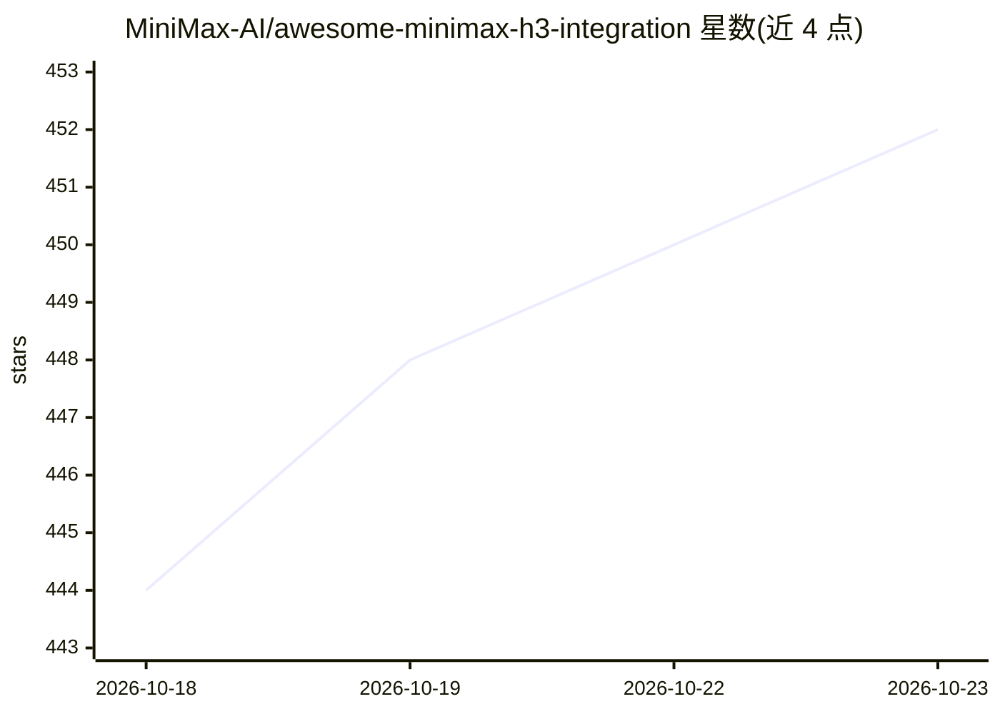

# MiniMax-AI/awesome-minimax-h3-integration

⭐ 452 · 推送 2026-10-17 · [GitHub](https://github.com/MiniMax-AI/awesome-minimax-h3-integration) · 组织维护 · 中文 README

**MiniMax H3 视频生成模型的社区集成与工具索引清单**

由 MiniMax-AI 仓库承载、社区维护的 MiniMax-H3（文/图/视频/音频输入生成带原生立体声视频的模型）生态导航清单：按开发者目标（本地运行、ComfyUI 集成、加速、控制、微调、API 服务）组织条目，核心是一张按 VRAM/硬件分档（8 GB 笔记本到 H200/B200）的运行栈对照表，并汇总官方与社区量化 checkpoint（BF16/INT8/FP8/NVFP4/GGUF 等）的规格与下载链接。清单本身非可安装软件，量化文件为社区转换而非官方发布。

## 筛选速览

| 维度 | 判定 | 备注 |
|---|---|---|
| AI 角色 | `ai-knowledge` | 知识聚合/清单类 |
| 许可风险 | `none` | — |
| 部署形态 | `None` |  |
| 模型依赖 | local-ok | 支持本地模型 |
| 硬件要求 | — | 无带数字的原话,不猜 |
| 安装摩擦 | `medium` | 含编译或系统依赖之一 |
| 成熟度 | — | 结构信号不足 |

## 能力要点

- 按 VRAM 分档（8 GB–B200）的本地运行栈对照表
- 官方与社区量化 checkpoint 规格及 Hugging Face 下载链接索引
- 覆盖 ComfyUI 节点、加速方案、控制网、Apple Silicon（h3.c）等工具条目
- 区分 FL2VA 与 Ref2VA 两种基座变体的能力与文件构成

## 适用场景

- 按自己 GPU 显存挑选 MiniMax-H3 的量化版本与运行栈
- 查找 ComfyUI 工作流、加速与控制类扩展工具
- 对比官方与社区 checkpoint 的精度、体积与来源

## 场景标签

`视频生成` `精选清单` · 领域:内容生成

## 证据(README 行号)

> L5: A community-maintained index of checkpoints, tools, and workflows for MiniMax H3, ordered by developer interest.
> L44: |Situation|Stack|Why this combination|

## 星数曲线

2026-10-18 444 → 2026-10-23 452（+8）

---
*卡片 v1 · prompt 1.4 · 生成 2026-10-21 · 置信度 high · 依据 README sha `85d9911df846` · [字段定义](../../DATASET.md)*
