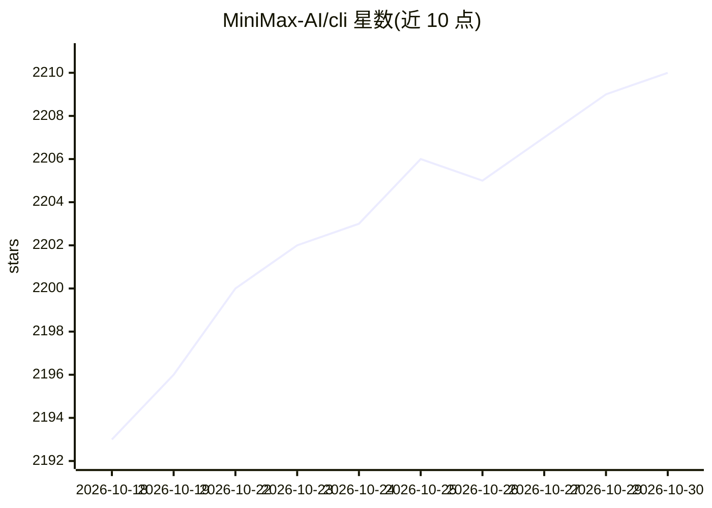

# MiniMax-AI/cli

⭐ 2,210 · TypeScript · 推送 2026-10-19 · [GitHub](https://github.com/MiniMax-AI/cli) · [官网](https://platform.minimax.io/subscribe/token-plan) · 组织维护 · 中文 README

**MiniMax 官方 CLI：在终端/Agent 中调用文本、图像、视频、语音生成**

MiniMax 官方命令行工具，面向 AI agent 与终端用户，通过 MiniMax API 平台生成多轮对话文本、图像、异步视频、TTS 语音（30+ 音色）、语音转文字与图像理解，并提供 Web 搜索命令。支持 Global 与 CN 双区域，认证支持 OAuth（RFC 8628+PKCE）与 API key，可配置 Claude Code、Codex、Zed 等编码 agent 使用 MiniMax 模型。需 Node.js 18+ 与 MiniMax Token Plan。

## 筛选速览

| 维度 | 判定 | 备注 |
|---|---|---|
| AI 角色 | `ai-ecosystem` | LLM/agent 周边工具 |
| 许可风险 | `permissive` | — |
| 部署形态 | `library` | 以包/库形式分发 |
| 模型依赖 | — | README 未给出锁定关系 |
| 硬件要求 | — | 无带数字的原话,不猜 |
| 安装摩擦 | `low` | 无编译、无系统依赖或容器化 |
| 成熟度 | — | 结构信号不足 |

## 能力要点

- 文本/图像/视频/语音/视觉/搜索六类生成命令
- 语音转文字支持 json/verbose_json/srt/vtt 输出格式
- OAuth 与 API key 双认证，Global/CN 双区域自动探测
- mmx agent setup 为 Claude Code、Codex 等 8 种编码 agent 写入配置

## 适用场景

- 在终端用命令生成图像、视频或合成语音
- 为 Claude Code / Codex 等编码 agent 配置 MiniMax 模型
- 将音频转录为带时间戳的字幕文件

## 场景标签

`图像生成` `视频生成` `语音合成` `语音识别` · 领域:内容生成

## 证据(README 行号)

> L3:  The official CLI for the MiniMax AI Platform
> L4:  Built for AI agents. Generate text, images, video, and speech — from any agent or terminal.
> L176: ### `mmx agent setup`

## 星数曲线

2026-10-18 2,193 → 2026-10-30 2,210（+17）

---
*卡片 v1 · prompt 1.4 · 生成 2026-10-21 · 置信度 high · 依据 README sha `4928c8573d4e` · [字段定义](../../DATASET.md)*
