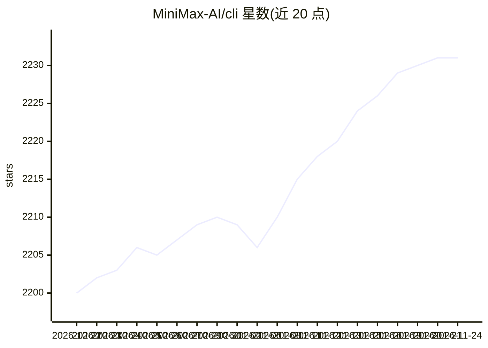

# MiniMax-AI/cli

⭐ 2,231 · TypeScript · 推送 2026-11-10 · [GitHub](https://github.com/MiniMax-AI/cli) · [官网](https://platform.minimax.io/subscribe/token-plan) · 组织维护

**MiniMax 官方 CLI：从终端/Agent 生成文本、图像、视频、语音**

MiniMax AI 平台的官方命令行工具，通过调用平台 API 提供 text（多轮对话/流式/JSON 输出）、image（文生图/图像编辑）、video（异步生成与进度跟踪）、speech（TTS 与语音转写）、vision（图像理解）和 web search 六类命令。面向终端用户与 AI Agent 两类使用方式：支持 npx skills 添加到 Agent，`mmx agent setup` 可为 Claude Code、Codex、Zed 等 Agent 写入配置。需 Node.js 18+ 与 MiniMax Token Plan，支持 Global/CN 双区域 OAuth 或 API key 认证。

## 筛选速览

| 维度 | 判定 | 备注 |
|---|---|---|
| AI 角色 | `ai-ecosystem` | LLM/agent 周边工具 |
| 许可风险 | `permissive` | — |
| 部署形态 | `library` | 以包/库形式分发 |
| 模型依赖 | — | README 未给出锁定关系 |
| 硬件要求 | — | 无带数字的原话,不猜 |
| 安装摩擦 | `low` | 无编译、无系统依赖或容器化 |
| 成熟度 | — | 结构信号不足 |

## 能力要点

- 六类生成命令：text/image/video/speech/vision/search
- 双区域支持：Global (api.minimax.io) 与 CN (api.minimaxi.com)
- OAuth (RFC 8628 + PKCE) 与 API key 双认证，自动区域探测
- mmx agent setup 为 Claude Code/Codex/Zed 等 Agent 配置 MiniMax

## 适用场景

- 在终端里调用 MiniMax 生成文本、图像、视频或语音
- 把 MiniMax 作为 Claude Code/Codex 等编码 Agent 的模型后端
- 在 CI/CD 中用 API key 调用语音转写或文生图

## 场景标签

`图像生成` `语音合成` `语音识别` `视频生成` · 领域:内容生成

## 证据(README 行号)

> L3:  The official CLI for the MiniMax AI Platform
> L27: # For AI agents (OpenClaw, Cursor, Claude Code, etc.): add skill to your agent
> L183: Configure MiniMax for Claude Code, Codex, Grok Build, OpenCode, Hermes, Pi, Oh my Pi, or Zed while preserving unre

## 星数曲线

2026-10-22 2,200 → 2026-11-24 2,231（+31）

---
*卡片 v1 · prompt 1.4 · 生成 2026-11-23 · 置信度 high · 依据 README sha `1e23e7a3de7a` · [字段定义](../../DATASET.md)*
