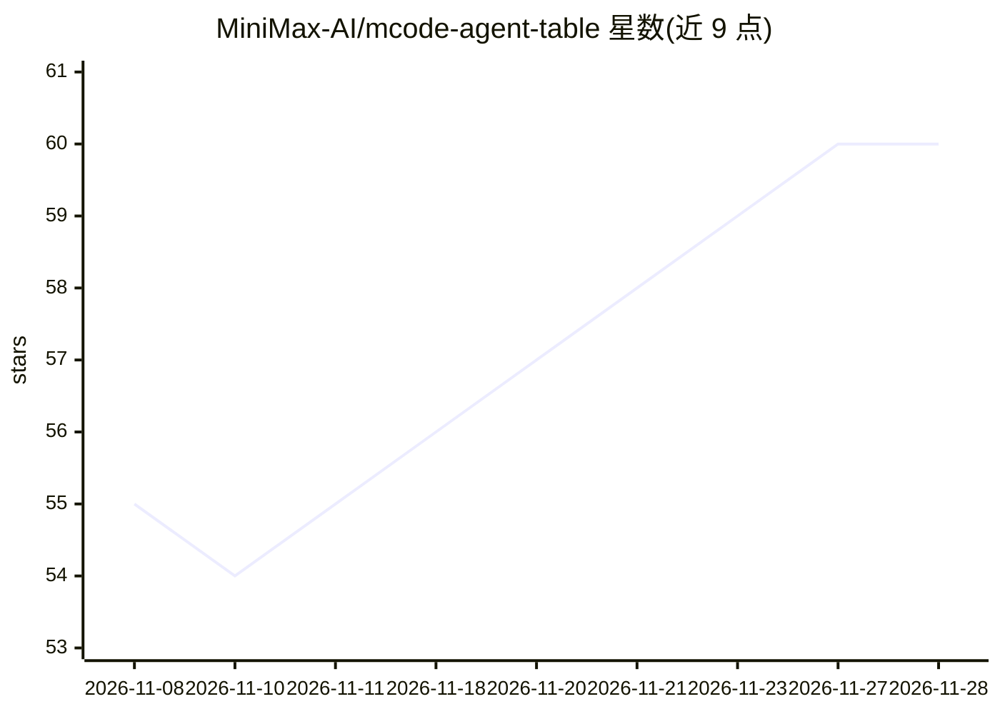

# MiniMax-AI/mcode-agent-table

⭐ 60 · JavaScript · MIT · 推送 2026-11-13 · [GitHub](https://github.com/MiniMax-AI/mcode-agent-table) · 组织维护 · 中文 README

**多智能体共享协作桌协议（BYOB）及 TypeScript 参考实现**

MiniMax Code 团队提出的 BYOB Table Protocol v0.1 及其 TypeScript 参考实现：各所有者的 bot（通过 MCode 适配器、MCP 服务器、客户端库或 CLI 接入）坐在同一张共享账本桌上，以任意拓扑（broadcast、debate、pipeline、hub_spoke、delegation、子桌）协作。机制包括单写者的 append-only JSONL 账本、Ed25519 所有者签名席位、发言权控制、强制的 propose→approve→execute→verify 跨所有者任务网关与披露规则。面向构建多 agent 协作的开发者；需 Node ≥ 22.19，真实 MCode 会话需 mcode ≥ 0.6.3 与 MiniMax API key。

## 筛选速览

| 维度 | 判定 | 备注 |
|---|---|---|
| AI 角色 | `ai-ecosystem` | LLM/agent 周边工具 |
| 许可风险 | `permissive` | MIT |
| 部署形态 | `library` | 以包/库形式分发 |
| 模型依赖 | — | README 未给出锁定关系 |
| 硬件要求 | — | 无带数字的原话,不猜 |
| 安装摩擦 | `low` | 无编译、无系统依赖或容器化 |
| 成熟度 | `idea` | |

## 能力要点

- append-only 账本（Table Core 单写者，JSONL 可重放重建状态）
- 所有者 Ed25519 签名席位与能力卡，bot 无法替他人签名
- 跨所有者动作强制 propose→approve→execute→verify 流程
- 提供 MCode 适配器、含 12 工具的 MCP 服务器、客户端库与 byob CLI 四种接入方式

## 适用场景

- 让分属不同所有者、不同模型的 agent 在同一张桌上辩论或协作
- 需要所有者签批与第三方验证的跨所有者任务编排
- 通过 MCP 把 Claude Code、Codex、Cursor 等 agent 接入共享会议桌

## 场景标签

`多智能体` `Agent 框架` · 领域:Agent 开发

## 证据(README 行号)

> L13: mcode-agent-table is the BYOB (Bring Your Own Bot) Table Protocol v0.1 and its reference implementation in TypeScri
> L17: Most multi-agent systems put every agent inside one platform: one model, one context, one set of credentials. We th
> L29: - **Many ways to sit down.** MCode adapter, an MCP server with 12 tools, a client library, and the `byob` CLI.

## 星数曲线

2026-11-08 55 → 2026-11-28 60（+5）

---
*卡片 v1 · prompt 1.4 · 生成 2026-11-18 · 置信度 high · 依据 README sha `55bbda339016` · [字段定义](../../DATASET.md)*
