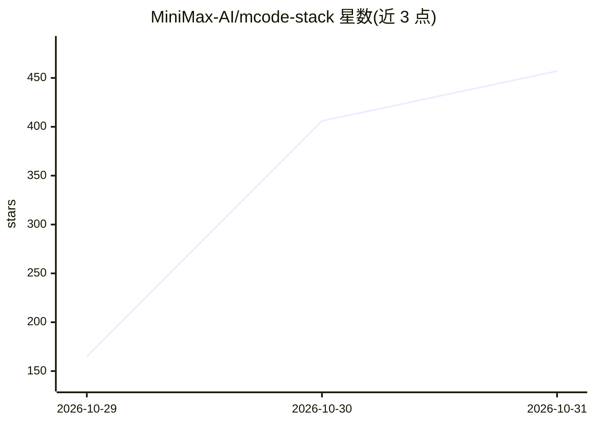

# MiniMax-AI/mcode-stack

⭐ 457 · Python · MIT · 推送 2026-10-29 · [GitHub](https://github.com/MiniMax-AI/mcode-stack) · 组织维护 · 中文 README

**MiniMax Code 团队日常使用的 AI 编码工作流与技能合集**

由 MiniMax Code 团队开源的 agent 技能与工作流仓库：15 个 SKILL.md 格式技能按计划拆分、上下文与工具、长会话与长命令、代码评审、实验与热修等场景组织，另含每人的 WORKFLOW.md 与配套 Engineering Notes 文章索引。技能可复制到 ~/.agents/skills 目录、以本地插件或插件市场方式安装进 MiniMax Code，同一目录也兼容 Claude Code；仓库不含 MiniMax Code 源码。MIT 许可（个别 stack 有 NOTICE 例外）。

## 筛选速览

| 维度 | 判定 | 备注 |
|---|---|---|
| AI 角色 | `ai-knowledge` | 知识聚合/清单类 |
| 许可风险 | `permissive` | MIT |
| 部署形态 | `None` |  |
| 模型依赖 | — | README 未给出锁定关系 |
| 硬件要求 | — | 无带数字的原话,不猜 |
| 安装摩擦 | `low` | 无编译、无系统依赖或容器化 |
| 成熟度 | — | 结构信号不足 |

## 能力要点

- 15 个 SKILL.md 技能，覆盖子代理拆分、上下文审计、长命令检查、代码评审等环节
- 每个 stack 同时是 MiniMax Code 插件包，仓库本身即插件市场
- 采用通用 SKILL.md 格式，多数技能可在其他支持 skills 的 agent 中使用
- 与 MCode Engineering Notes 文章系列配套，提供 stack 模板与贡献流程

## 适用场景

- 把团队工程实践以技能形式装进我的编码 agent
- 查找子代理拆分、上下文预算、长会话管理等方面的可运行检查清单
- 以模板为基础沉淀并分享自己的 agent 工作流

## 场景标签

`代码审查` `提示工程` · 领域:Agent 开发

## 证据(README 行号)

> L10: **The workflows and skills the MiniMax Code team uses to build MiniMax Code. Open source, install and use.**
> L16: goes into context on every turn. Each piece is a `SKILL.md` skill or
> L74: The skills use the common `SKILL.md` format, so most of them also work in

## 星数曲线

2026-10-29 165 → 2026-10-31 457（+292）

---
*卡片 v1 · prompt 1.4 · 生成 2026-10-28 · 置信度 high · 依据 README sha `40c10b713243` · [字段定义](../../DATASET.md)*
