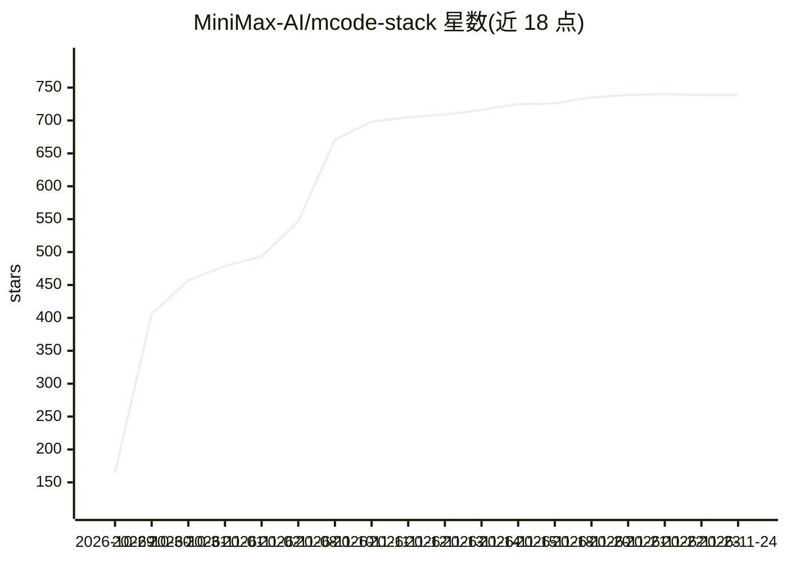

# MiniMax-AI/mcode-stack

⭐ 742 · JavaScript · MIT · 推送 2026-11-11 · [GitHub](https://github.com/MiniMax-AI/mcode-stack) · 组织维护 · 中文 README

**MiniMax Code 团队的 AI 编码工作流与技能包合集**

该仓库收录 MiniMax Code 团队日常使用的编码工作流、SKILL.md 技能与检查清单，按成员分为四个 stack（ronny/jiachen/req-tpm/youfang），覆盖子代理拆分判断、小 PR 拆分、上下文与工具预算审计、长会话压缩与交接文档、独立代码评审、PR 评审 CI 化、需求 TPM 流程及幻灯片生成等内容。通过 Claude Code/Codex 插件市场一键安装，或以 git clone 后复制到 ~/.agents/skills/ 使用；README 明确不含 MiniMax Code 本体源码。

## 筛选速览

| 维度 | 判定 | 备注 |
|---|---|---|
| AI 角色 | `ai-knowledge` | 知识聚合/清单类 |
| 许可风险 | `permissive` | MIT |
| 部署形态 | `None` |  |
| 模型依赖 | — | README 未给出锁定关系 |
| 硬件要求 | — | 无带数字的原话,不猜 |
| 安装摩擦 | `low` | 无编译、无系统依赖或容器化 |
| 成熟度 | — | 结构信号不足 |

## 能力要点

- 四套成员 stack，含 20+ SKILL.md 技能与检查清单
- 支持 Claude Code 与 Codex 插件市场一键安装，兼容 SKILL.md 格式的其他 agent
- 技能与 MCode Engineering Notes 文章一一配套，文章讲解理念、仓库使其可运行
- 本仓库仅含工作流与技能，不含 MiniMax Code 源码

## 适用场景

- 为编码 agent 安装一套现成的代码评审与上下文管理技能
- 把重复纠正的工程习惯固化为测试、lint 或 CI 步骤
- 为 PR 评审建立可调规则的自动化循环

## 场景标签

`编码 Agent` `代码审查` · 领域:编码与开发

## 证据(README 行号)

> L1: MCode Stack: the workflows and skills the MiniMax Code team uses to build MiniMax Code
> L16: goes into context on every turn. Each piece is a `SKILL.md` skill or
> L104: The skills use the common `SKILL.md` format, so most of them also work in

## 星数曲线

2026-10-29 165 → 2026-11-24 739（+574）

---
*卡片 v1 · prompt 1.4 · 生成 2026-11-24 · 置信度 high · 依据 README sha `fd6e76eb7e07` · [字段定义](../../DATASET.md)*
