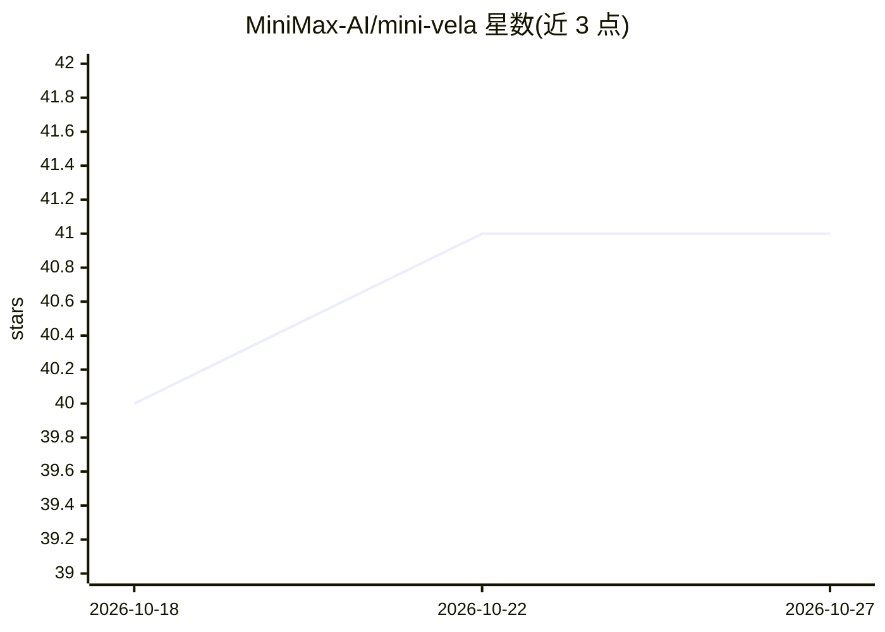

# MiniMax-AI/mini-vela

⭐ 41 · Python · 推送 2026-04-02 · [GitHub](https://github.com/MiniMax-AI/mini-vela) · 组织维护 · 中文 README

**评测 AI 编程 Agent 指令遵循能力的基准框架（OctoBench）**

MiniMax 发布的 OctoBench 基准框架：通过在宿主机运行 LiteLLM Proxy 拦截 API 调用，采集 Claude Code、Kilo-Dev、Droid 等 scaffold 完成任务的完整交互轨迹（JSONL 记录），经 convert 工具去重合并后由 LLM 按 Checklist 多维度自动评分；每个任务实例运行在隔离的 Docker 容器中。任务数据来自 MiniMaxai/OctoBench 数据集，需 Python 3.11+、Docker 与 LLM API Key，MIT 许可。

## 筛选速览

| 维度 | 判定 | 备注 |
|---|---|---|
| AI 角色 | `ai-ecosystem` | LLM/agent 周边工具 |
| 许可风险 | `none` | — |
| 部署形态 | `self-host` | docker 或自建部署 |
| 模型依赖 | — | README 未给出锁定关系 |
| 硬件要求 | — | 无带数字的原话,不猜 |
| 安装摩擦 | `low` | 无编译、无系统依赖或容器化 |
| 成熟度 | — | 结构信号不足 |

## 能力要点

- LiteLLM Proxy 拦截并记录完整 API 调用轨迹
- 支持 Claude Code、Kilo-Dev、Droid 等多种 scaffold
- 基于 Checklist 的 LLM 自动多维评分
- 每个任务实例在隔离 Docker 容器中运行

## 适用场景

- 评测 AI 编程 Agent 在仓库级任务上的指令遵循能力
- 采集并留存 Agent 完整交互轨迹用于分析
- 对比不同 scaffold 工具的任务完成表现

## 场景标签

`模型评测` · 领域:评测与运维

## 证据(README 行号)

> L14: A benchmark framework for evaluating instruction-following capabilities of AI Coding Agents. It intercepts API call
> L20: - **Automated Evaluation**: Multi-dimensional scoring of trajectories using LLM based on Checklist

## 星数曲线

2026-10-18 40 → 2026-10-27 41（+1）

---
*卡片 v1 · prompt 1.4 · 生成 2026-10-25 · 置信度 mid · 依据 README sha `9a4256f2d368` · [字段定义](../../DATASET.md)*
