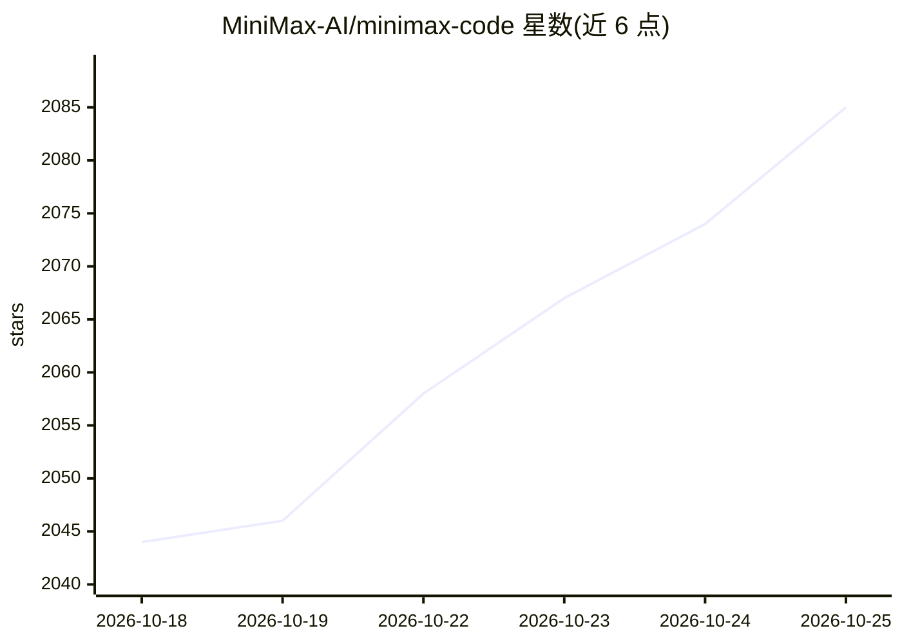

# MiniMax-AI/minimax-code

⭐ 2,085 · TypeScript · MIT · 推送 2026-10-24 · [GitHub](https://github.com/MiniMax-AI/minimax-code) · [官网](https://agent.minimax.io/download) · 组织维护 · 中文 README

**终端编码 Agent CLI：用 MiniMax 或自有模型把提示词变成可运行代码**

MiniMax 开源的终端编码 Agent（MCode）：提供交互式 TUI、headless exec 与 ACP 三种入口，可读文件、改代码、跑命令与测试，带权限与沙箱控制、会话恢复、AGENTS.md 项目指引生成与 lightweight 对话模式。默认登录 MiniMax 账号（含国内/Global 区域），也支持 BYOK 接入 OpenAI 兼容或 Anthropic 兼容的自有/自托管模型端点，可设上下文与输出上限。安装提供官方脚本（macOS/Linux/WSL、Windows PowerShell）与 npm 两条途径，要求 Node.js 22.19+/24.2+/25/26；单文件安装脚本不支持 Alpine/musl Linux。

## 筛选速览

| 维度 | 判定 | 备注 |
|---|---|---|
| AI 角色 | `ai-native` | 本体是模型或模型工具 |
| 许可风险 | `permissive` | MIT |
| 部署形态 | `library` | 以包/库形式分发 |
| 模型依赖 | — | README 未给出锁定关系 |
| 硬件要求 | — | 无带数字的原话,不猜 |
| 安装摩擦 | `low` | 无编译、无系统依赖或容器化 |
| 成熟度 | — | 结构信号不足 |

## 能力要点

- 交互式 TUI、headless exec、ACP 三种入口，支持会话恢复与权限/沙箱控制
- BYOK 接入 openai-completions/openai-responses/anthropic-messages 三种 API 格式
- 一键安装脚本无需 sudo，自动准备兼容 Node.js 运行时
- lightweight 模式用于纯对话，不携带工具 schema 与工作区上下文

## 适用场景

- 在终端用自然语言让 Agent 修 bug、跑测试并审查改动
- CI/脚本中用 mcode exec 批量执行编码任务
- 接入自有 OpenAI/Anthropic 兼容模型端点做编码助手

## 场景标签

`编码 Agent` · 领域:编码与开发

## 证据(README 行号)

> L4:  Turn a prompt into something that works. Build, test, and keep iterating from your terminal—with MiniMax or your ow
> L239: |**Choose your model**|Use a MiniMax account / Token Plan, or custom providers with OpenAI- or Anthropic-compatibl

## 星数曲线

2026-10-18 2,044 → 2026-10-25 2,085（+41）

---
*卡片 v1 · prompt 1.4 · 生成 2026-10-21 · 置信度 high · 依据 README sha `725eebaa2e6f` · [字段定义](../../DATASET.md)*
