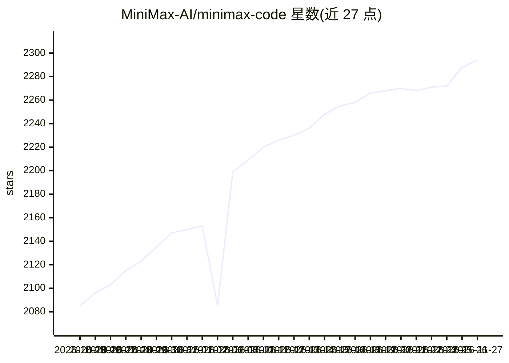

# MiniMax-AI/minimax-code

⭐ 2,294 · TypeScript · MIT · 推送 2026-11-17 · [GitHub](https://github.com/MiniMax-AI/minimax-code) · [官网](https://agent.minimax.io/download) · 组织维护 · 中文 README

**开发者终端里的开源编码代理 CLI，由 MiniMax 模型驱动**

运行于终端的编码代理（MCode），提供交互式 TUI、headless（mcode exec）、ACP 与 TypeScript SDK 四种入口，可读取文件、检查 diff、运行 shell 命令与测试，并通过权限与沙箱控制工具执行。默认接入 MiniMax 账号（Token Plan 需可用额度），也支持 BYOK：以 openai-completions、openai-responses 或 anthropic-messages 格式接入第三方或自托管端点。安装方式为官方一键脚本或 npm 全局包，需 Node.js 22.19+；Alpine/musl 不支持一键安装脚本。

## 筛选速览

| 维度 | 判定 | 备注 |
|---|---|---|
| AI 角色 | `ai-native` | 本体是模型或模型工具 |
| 许可风险 | `permissive` | MIT |
| 部署形态 | `library` | 以包/库形式分发 |
| 模型依赖 | — | README 未给出锁定关系 |
| 硬件要求 | — | 无带数字的原话,不猜 |
| 安装摩擦 | `low` | 无编译、无系统依赖或容器化 |
| 成熟度 | — | 结构信号不足 |

## 能力要点

- 四种入口：TUI、headless exec、ACP、TypeScript SDK
- BYOK 支持三种 API 格式接入自定义/本地模型
- 权限与沙箱控制工具执行，支持会话恢复与子 agent
- 提供 lightweight 会话模式（不加载工具与工作区上下文）

## 适用场景

- 在终端里让代理查找并修复失败测试后运行验证
- 在 CI 或脚本中以 headless 模式批量执行编码任务
- 用自有 API key 或自托管端点驱动编码代理
- 通过 MCP 与媒体工具进行搜索和媒体处理

## 场景标签

`编码 Agent` · 领域:编码与开发

## 证据(README 行号)

> L4:  Turn a prompt into something that works. Build, test, and keep iterating from your terminal—with MiniMax or your ow
> L93: Supported API formats: `openai-completions`, `openai-responses`, and `anthropic-messages`. See the model examples f

## 星数曲线

2026-10-25 2,085 → 2026-11-27 2,294（+209）

---
*卡片 v1 · prompt 1.4 · 生成 2026-11-23 · 置信度 high · 依据 README sha `4f9a6adf3df3` · [字段定义](../../DATASET.md)*
