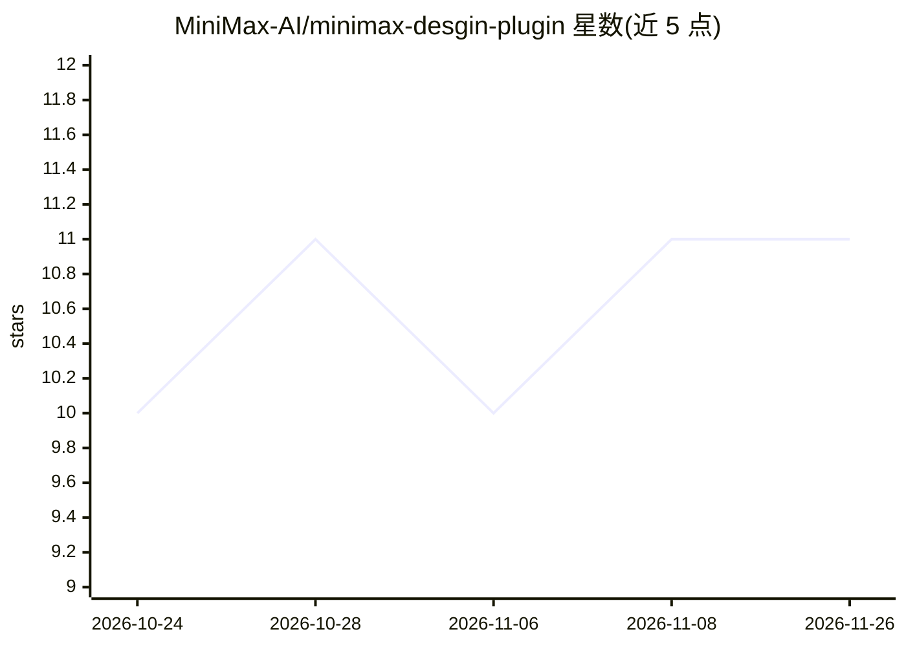

# MiniMax-AI/minimax-desgin-plugin

⭐ 11 · TypeScript · 推送 2026-08-20 · [GitHub](https://github.com/MiniMax-AI/minimax-desgin-plugin) · 组织维护 · 中文 README

**ComfyUI 插件：为 MiniMax Design 提供可视化工作流与本地推理**

MiniMax 官方开源的 ComfyUI 插件，为 MiniMax Design 创作产品提供可视化工作流编辑与本地推理能力。仓库含两部分：基于 ComfyUI Frontend 的工作流界面与基于 ComfyUI 的 Python 推理后端。代码为自动同步的源码快照，不含构建产物、依赖、模型文件与部署工具，更多说明需查阅子目录 README。项目派生自 ComfyUI 与 ComfyUI Frontend，以 GPL-3.0 许可发布。

## 筛选速览

| 维度 | 判定 | 备注 |
|---|---|---|
| AI 角色 | `ai-native` | 本体是模型或模型工具 |
| 许可风险 | `none` | — |
| 部署形态 | `None` |  |
| 模型依赖 | — | README 未给出锁定关系 |
| 硬件要求 | — | 无带数字的原话,不猜 |
| 安装摩擦 | `low` | 无编译、无系统依赖或容器化 |
| 成熟度 | — | 结构信号不足 |

## 能力要点

- 基于 ComfyUI 的可视化工作流编辑界面（frontend）
- 基于 ComfyUI 的 Python 本地推理后端（backend）
- 服务于 design.minimax.cn 与 design.minimax.io 产品
- 以 GPL-3.0 许可开源并保留上游署名

## 适用场景

- 在 ComfyUI 中以可视化工作流方式使用 MiniMax Design 的生成能力
- 本地部署推理后端配合 MiniMax 创作产品使用

## 场景标签

`图像生成` · 领域:内容生成

## 证据(README 行号)

> L7: 本仓库包含 **MiniMax Design Plugin for ComfyUI** 的开源代码。该项目基于 ComfyUI，为 MiniMax 创作产品提供可视化工作流编辑与本地推理能力。
> L20: ├── frontend/   # 基于 ComfyUI Frontend 的工作流界面
> L21: └── backend/    # 基于 ComfyUI 的 Python 推理后端

## 星数曲线

2026-10-24 10 → 2026-11-26 11（+1）

---
*卡片 v1 · prompt 1.4 · 生成 2026-11-19 · 置信度 mid · 依据 README sha `3f6e4738e61e` · [字段定义](../../DATASET.md)*
