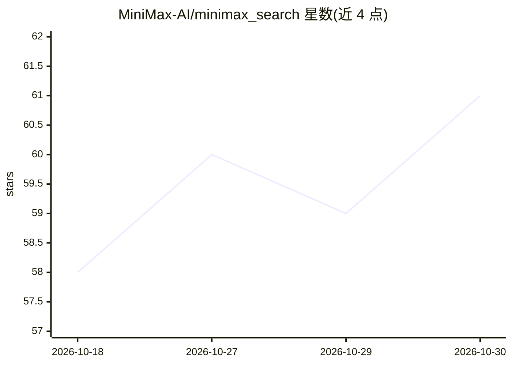

# MiniMax-AI/minimax_search

⭐ — · [GitHub]() · 组织维护 · 中文 README

**为 Agent 提供网页搜索与批量浏览能力的 MCP 服务器**

基于标准 MCP 协议（stdio 通信，实现 list_tools/call_tool）的服务器，向 Agent 客户端暴露两个工具：search 支持多查询并行网页搜索（经 Serper API 使用 Google 引擎，支持 Google 高级搜索语法），browse 批量访问 URL，用 Jina Reader 抽取网页内容转 Markdown，再由 MiniMax LLM 理解内容并回答问题。搜索失败时自动切换引擎。需配置 SERPER_API_KEY、JINA_API_KEY、MINIMAX_API_KEY 环境变量。通过 uvx 从 Git 仓库或本地路径运行。

## 筛选速览

| 维度 | 判定 | 备注 |
|---|---|---|
| AI 角色 | `ai-ecosystem` | LLM/agent 周边工具 |
| 许可风险 | `none` | — |
| 部署形态 | `None` |  |
| 模型依赖 | — | README 未给出锁定关系 |
| 硬件要求 | — | 无带数字的原话,不猜 |
| 安装摩擦 | `low` | 无编译、无系统依赖或容器化 |
| 成熟度 | — | 结构信号不足 |

## 能力要点

- search 工具支持多查询并行搜索与 Google 高级语法
- browse 工具批量读页，Jina Reader 转 Markdown 后由 MiniMax LLM 生成回答
- 标准 MCP 协议实现（stdio 通信）
- 搜索失败时自动切换引擎

## 适用场景

- 为 MCP 客户端/Agent 接入网页搜索能力
- 让 Agent 批量浏览多个网页并总结内容
- Agent 会话中并行执行多个搜索查询

## 场景标签

`网页抓取` · 领域:效率与自动化

## 证据(README 行号)

> L5: MiniMax Search is an MCP (Model Context Protocol) server that provides web search and browsing capabilities.
> L113: Once the MCP server is started, the Agent can use the following tools:

## 星数曲线

2026-10-18 58 → 2026-10-30 61（+3）

---
*卡片 v1 · prompt 1.4 · 生成 2026-10-24 · 置信度 high · 依据 README sha `35bf4507fa5c` · [字段定义](../../DATASET.md)*
