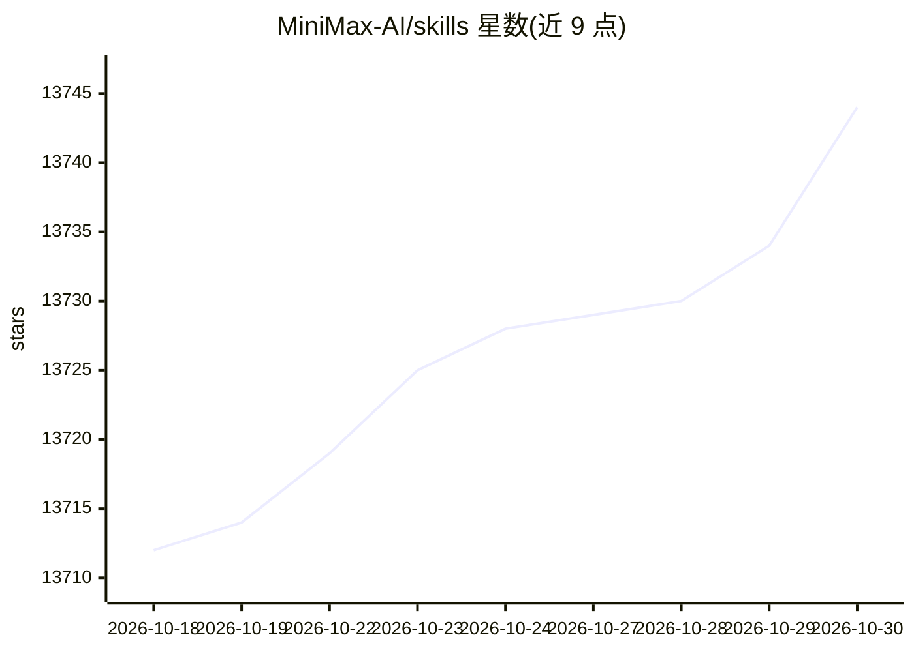

# MiniMax-AI/skills

⭐ 13,744 · C# · MIT · 推送 2026-04-18 · [GitHub](https://github.com/MiniMax-AI/skills) · 组织维护 · 中文 README

**为 AI 编程 agent 提供前端/全栈/移动端开发技能包**

MiniMax 维护的 AI 编程 agent 技能集合，提供 16 个技能，覆盖前端、全栈、Android/iOS 原生、Flutter、React Native 与 GLSL shader 开发，另含 PDF/PPTX/XLSX/DOCX 文档生成及音乐、视频、图像等多模态生成技能（部分依赖 MiniMax API）。安装方式为通过 Claude Code 插件市场安装，或以 git clone 后软链方式接入 Cursor、Codex、OpenCode；VS Code 无独立扩展，需在集成终端运行支持的 CLI 工具。项目处于 Beta 阶段，接口与配置格式可能变动。

## 筛选速览

| 维度 | 判定 | 备注 |
|---|---|---|
| AI 角色 | `ai-ecosystem` | LLM/agent 周边工具 |
| 许可风险 | `permissive` | MIT |
| 部署形态 | `None` |  |
| 模型依赖 | — | README 未给出锁定关系 |
| 硬件要求 | — | 无带数字的原话,不猜 |
| 安装摩擦 | `medium` | 含编译或系统依赖之一 |
| 成熟度 | `idea` | |

## 动量与使用信号

- 维护:`declining` — 距上次 push 183.0 天,年发版 0,15 位贡献者
- 涨星:近 1 天 **-1**(自 20261016 起算)
- 平台:WINDOWS / ANDROID / IOS · 协议:—

## 能力要点

- 16 个技能覆盖前端、全栈、Android/iOS、Flutter、React Native、shader 开发
- 部分技能通过 MiniMax API 调用图像/视频/音频/TTS 生成能力
- 支持 Claude Code、Cursor、Codex、OpenCode 四种 agent 工具接入
- 文档生成技能覆盖 PDF、PPTX、XLSX、DOCX 四种格式

## 适用场景

- 给 Claude Code 等 AI 编程工具加装前端/全栈开发指导技能
- 在编程 agent 中生成 PDF、PPT 等办公文档
- 通过 agent 调用 MiniMax API 生成音乐、视频与图像素材

## 场景标签

`语音合成` `图像生成` `视频生成` · 领域:内容生成

## 证据(README 行号)

> L7: Development skills for AI coding agents. Plug into your favorite AI coding tool and get structured, production-quali
> L33: ### Claude Code
> L43: git clone https://github.com/MiniMax-AI/skills.git ~/.cursor/minimax-skills

## 星数曲线

2026-10-18 13,712 → 2026-10-30 13,744（+32）

---
*卡片 v1 · prompt 1.4 · 生成 2026-10-18 · 置信度 high · 依据 README sha `45d6a524b815` · [字段定义](../../DATASET.md)*
