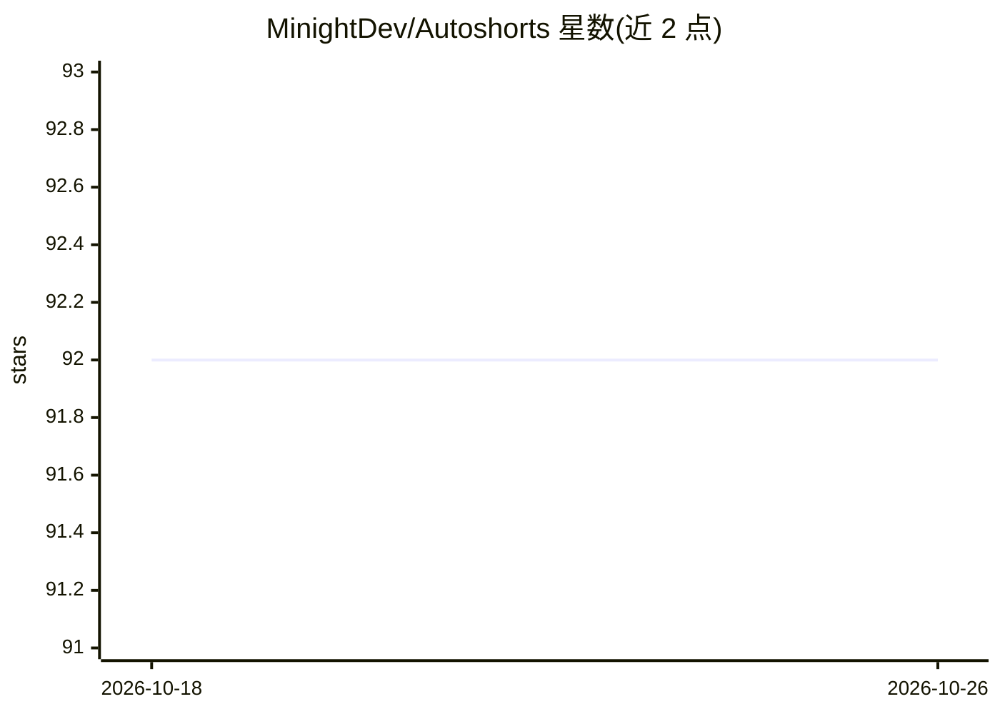

# MinightDev/Autoshorts

⭐ 92 · TypeScript · 推送 2026-01-23 · [GitHub](https://github.com/MinightDev/Autoshorts) · [官网](https://monzed.com/products) · 组织维护

**Monzed AI 短视频生成 API 的官方交互式 Playground**

基于 npm/Vite 的本地 Web Playground，用于接入 Monzed AutoShorts 云端 API：将长视频转换为竖版短视频，功能由远程服务执行，包括人脸跟踪、字幕动画、滤镜与配乐选择。Playground 暴露 config、content、captions、visuals、audio 五组 API 参数供调试，需配置 monzed.com 的付费 API key，按积分公式（Clips×5 + 源时长÷10）计费。面向希望原型化短视频 SaaS 的开发者与创始人。

## 筛选速览

| 维度 | 判定 | 备注 |
|---|---|---|
| AI 角色 | `ai-ecosystem` | LLM/agent 周边工具 |
| 许可风险 | `none` | — |
| 部署形态 | `library` | 以包/库形式分发 |
| 模型依赖 | — | README 未给出锁定关系 |
| 硬件要求 | — | 无带数字的原话,不猜 |
| 安装摩擦 | `low` | 无编译、无系统依赖或容器化 |
| 成熟度 | — | 结构信号不足 |

## 能力要点

- 将长视频自动剪辑为带人脸跟踪、字幕与配乐的短视频（云端 API 执行）
- 暴露 config/content/captions/visuals/audio 五组可调 API 参数
- 积分计费公式：Job Cost = (Clips × 5) + ceil(Source Minutes ÷ 10)
- 支持 CPU/GPU（NVIDIA T4）处理选项与 1080p/720p 分辨率

## 适用场景

- 调试 Monzed AutoShorts API 的参数组合与视觉预设
- 在本地原型化短视频生成 SaaS 的调用流程
- 测试不同 AI 人格风格（viral_hook/storytelling 等）的剪辑效果

## 场景标签

`视频生成` · 领域:内容生成

## 证据(README 行号)

> L5: **AutoShorts AI** transforms raw, long-form content into high-impact viral shorts. This repository provides the comp
> L35: VITE_API_BASE_URL=https://api.monzed.com/autoshorts/v1
> L91: - **401 Unauthorized**: Ensure your `mk_live_...` key is valid and has not expired.

## 星数曲线

2026-10-18 92 → 2026-10-26 92（+0）

---
*卡片 v1 · prompt 1.4 · 生成 2026-10-23 · 置信度 high · 依据 README sha `1bea691a42ce` · [字段定义](../../DATASET.md)*
