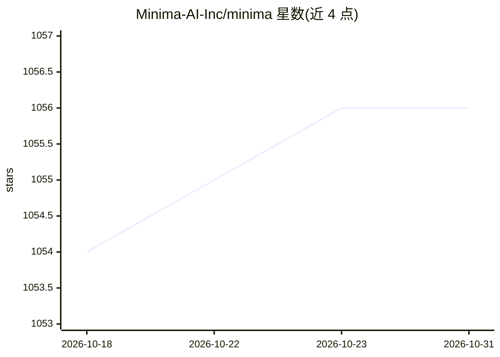

# Minima-AI-Inc/minima

⭐ 1,056 · Python · MPL-2.0 · 推送 2026-01-22 · [GitHub](https://github.com/Minima-AI-Inc/minima) · 组织维护

**本地部署的对话式 RAG 容器套件：用本地文档问答**

Minima 以 Docker Compose 容器组形式提供本地 RAG：索引本地文件夹（pdf/docx/xlsx/md 等 6 类），用 Sentence Transformer 嵌入、Qdrant 向量存储，支持四种模式——完全本地的 Ollama 模式（LLM/reranker/嵌入全部本地运行）、OpenAI 兼容自定义 LLM 模式（vLLM/TGI/LiteLLM 等）、ChatGPT custom GPT 集成、以及通过 MCP 接入 Claude Desktop 与 GitHub Copilot。提供 run.sh 快速脚本、Electron 桌面应用（npm 启动）和 localhost:3000 聊天界面。MPLv2 许可。

## 筛选速览

| 维度 | 判定 | 备注 |
|---|---|---|
| AI 角色 | `ai-native` | 本体是模型或模型工具 |
| 许可风险 | `permissive` | MPL-2.0 |
| 部署形态 | `self-host` | docker 或自建部署 |
| 模型依赖 | local-ok | 支持本地模型 |
| 硬件要求 | — | 无带数字的原话,不猜 |
| 安装摩擦 | `low` | 无编译、无系统依赖或容器化 |
| 成熟度 | — | 结构信号不足 |

## 能力要点

- 四种运行模式：Ollama 全本地 / OpenAI 兼容自定义 LLM / ChatGPT custom GPT / Claude MCP
- 递归索引本地文件夹，支持 .pdf/.xls/.docx/.txt/.md/.csv 六类格式
- Ollama 模式含查询增强与 CrossEncoder 重排序，自定义 LLM 模式为直检直答工作流
- MCP 服务器配置可接入 Claude Desktop 与 GitHub Copilot

## 适用场景

- 在本地或私有云上对自己的文档做问答，数据不出内网
- 复用已部署的 vLLM/TGI/Ollama 服务作为问答 LLM
- 在 ChatGPT 或 Claude 桌面端中查询本地文档

## 场景标签

`文档问答` · 领域:知识与检索

## 证据(README 行号)

> L3: **Minima** is an open source RAG on-premises containers, with ability to integrate with ChatGPT and MCP.
> L7: 1. **Isolated installation (Ollama)** – Operate fully on-premises with containers, free from external dependencies s
> L73: 9. Ask anything, and you'll get answers based on local files in {LOCAL_FILES_PATH} folder.

## 星数曲线

2026-10-18 1,054 → 2026-10-31 1,056（+2）

---
*卡片 v1 · prompt 1.4 · 生成 2026-10-21 · 置信度 high · 依据 README sha `b967dd7afc74` · [字段定义](../../DATASET.md)*
