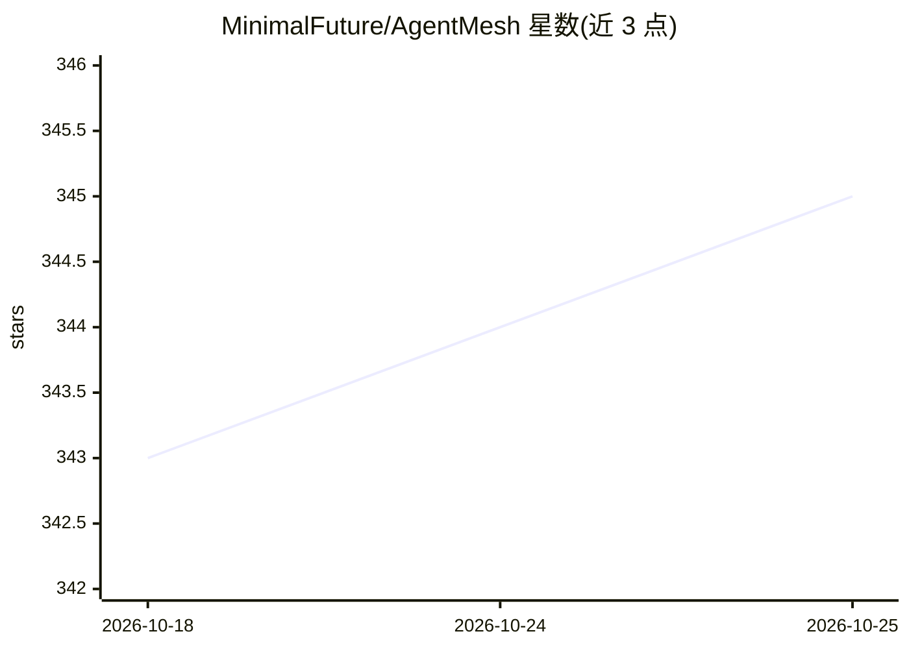

# MinimalFuture/AgentMesh

⭐ 345 · Python · Apache-2.0 · 推送 2026-04-01 · [GitHub](https://github.com/MinimalFuture/AgentMesh) · 个人维护 · 中文 README

**面向开发者的多智能体协作框架，快速组建 Agent 团队**

AgentMesh 是一个多智能体（Multi-Agent）平台，提供智能体间通信、任务规划与自主决策框架。开发者可定义角色、配置模型与工具，组建协作团队处理复杂任务。支持通过统一 API 接入 OpenAI、Claude、DeepSeek、Qwen 等模型，内置计算器、浏览器、搜索、文件、终端等工具；MCP 协议与远程异构智能体通信尚未实现（标注 coming soon）。提供 CLI、Docker 与 Python SDK 三种运行方式，Web 服务尚未发布。

## 筛选速览

| 维度 | 判定 | 备注 |
|---|---|---|
| AI 角色 | `ai-ecosystem` | LLM/agent 周边工具 |
| 许可风险 | `permissive` | Apache-2.0 |
| 部署形态 | `self-host` | docker 或自建部署 |
| 模型依赖 | locked-api |  |
| 硬件要求 | — | 无带数字的原话,不猜 |
| 安装摩擦 | `low` | 无编译、无系统依赖或容器化 |
| 成熟度 | — | 结构信号不足 |

## 能力要点

- 角色定义、任务分配与多轮自主决策的 Agent 团队机制
- 统一 API 接入 OpenAI/Claude/DeepSeek/Qwen 等多种模型
- 内置浏览器自动化、搜索、终端、文件等可扩展工具
- 支持 CLI、Docker、SDK 三种运行方式

## 适用场景

- 用命令行或 SDK 组建搜索研究型、软件开发型等多智能体团队
- 通过多智能体协作完成网页应用开发等复杂任务
- 为每个 Agent 分别定制模型、工具与系统提示词

## 场景标签

`多智能体` `Agent 框架` · 领域:Agent 开发

## 证据(README 行号)

> L5: AgentMesh is a **Multi-Agent platform** for AI agents building, providing a framework for inter-agent communication,
> L15: - **Agent Collaboration**: Support for role definition, task allocation, and multi-turn autonomous decision-making.

## 星数曲线

2026-10-18 343 → 2026-10-25 345（+2）

---
*卡片 v1 · prompt 1.4 · 生成 2026-10-22 · 置信度 high · 依据 README sha `f5eed6d53344` · [字段定义](../../DATASET.md)*
