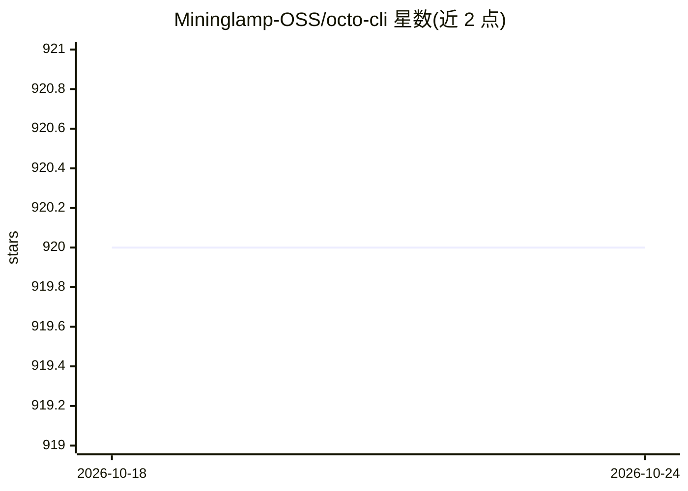

# Mininglamp-OSS/octo-cli

⭐ 920 · Go · Apache-2.0 · 推送 2026-10-23 · [GitHub](https://github.com/Mininglamp-OSS/octo-cli) · [官网](https://pkg.go.dev/github.com/Mininglamp-OSS/octo-cli) · 组织维护 · 中文 README

**面向 AI Agent 机器人的元数据驱动 CLI：调用 Octo 生态后端服务**

单二进制 Go 编写的 REST 命令行客户端，供 AI Agent 机器人（OpenClaw、Claude Code 等 agent 运行时）通过 exec 调用。命令树在启动时由内嵌的 OpenAPI 3.x 规范自动注册，新增端点只需修改规范。每次调用输出结构化 JSON 信封，错误走 stderr 并带确定性分类，无交互式 I/O。覆盖文档、HTML 文档、网络硬盘、消息、群组、线程、机器人生命周期、事件轮询与 Loop 集群控制面等域，共数十个操作。认证仅支持机器人令牌，不含交互式用户登录。

## 筛选速览

| 维度 | 判定 | 备注 |
|---|---|---|
| AI 角色 | `ai-ecosystem` | LLM/agent 周边工具 |
| 许可风险 | `permissive` | Apache-2.0 |
| 部署形态 | `desktop` | 安装包/桌面程序 |
| 模型依赖 | — | README 未给出锁定关系 |
| 硬件要求 | — | 无带数字的原话,不猜 |
| 安装摩擦 | `low` | 无编译、无系统依赖或容器化 |
| 成熟度 | — | 结构信号不足 |

## 能力要点

- 命令树由内嵌 OpenAPI 3.x 规范自动注册，改端点只需改规范
- 每次调用输出含身份、数据、分页与限流元数据的结构化 JSON 信封
- bot-only 认证：支持 app_*/bf_*/uk_*/octo_loop_* 四类凭据前缀
- skills/ 目录提供供 AI Agent 加载的机器可读使用文档

## 适用场景

- 在 agent 运行时中通过 exec 调用 Octo 生态后端的文档、消息、网盘等 API
- 为 agent 机器人提供带确定性错误分类与退出码的 CLI 工具
- 通过机器可读 skills 文档让 agent 学会使用该 CLI

## 场景标签

 · 领域:开发者工具/AI Agent 基础设施

## 证据(README 行号)

> L7: `octo-cli` is the command-line interface for the **Octo ecosystem** — a thin,
> L8: single-binary REST client designed for **AI Agent Bots** to call via `exec`
> L9: from agent runtimes (OpenClaw, Claude Code, and similar). Every invocation

## 星数曲线

2026-10-18 920 → 2026-10-24 920（+0）

---
*卡片 v1 · prompt 1.4 · 生成 2026-10-21 · 置信度 high · 依据 README sha `33b649bb2983` · [字段定义](../../DATASET.md)*
