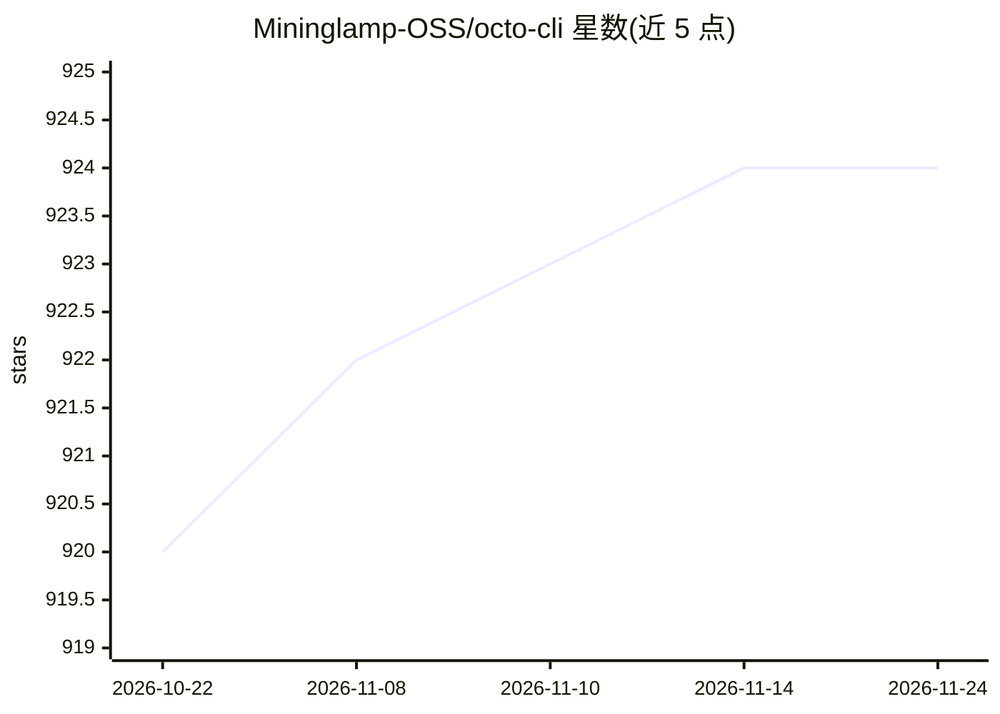

# Mininglamp-OSS/octo-cli

⭐ 924 · Go · Apache-2.0 · 推送 2026-11-23 · [GitHub](https://github.com/Mininglamp-OSS/octo-cli) · [官网](https://pkg.go.dev/github.com/Mininglamp-OSS/octo-cli) · 组织维护 · 中文 README

**供 AI Agent 通过 exec 调用的元数据驱动 REST CLI 客户端**

Octo 生态的命令行客户端，面向 AI Agent 运行时（OpenClaw、Claude Code 等）以 exec 方式调用。命令树由内嵌的 OpenAPI 3.x 规范在启动时自动注册，新增或修改端点只需编辑规范而非代码。每次调用在 stdout 输出含身份、数据、分页与限流元数据的结构化 JSON envelope，错误走 stderr 并使用固定错误分类，无交互式 I/O。覆盖文档、云盘、消息、群组、Loop 任务等域的操作，仅做传输、校验与格式化，业务逻辑在后端服务。

## 筛选速览

| 维度 | 判定 | 备注 |
|---|---|---|
| AI 角色 | `ai-ecosystem` | LLM/agent 周边工具 |
| 许可风险 | `permissive` | Apache-2.0 |
| 部署形态 | `desktop` | 安装包/桌面程序 |
| 模型依赖 | — | README 未给出锁定关系 |
| 硬件要求 | — | 无带数字的原话,不猜 |
| 安装摩擦 | `low` | 无编译、无系统依赖或容器化 |
| 成熟度 | — | 结构信号不足 |

## 能力要点

- 元数据驱动：命令树由内嵌 OpenAPI 3.x 规范自动注册
- 每次调用输出结构化 JSON envelope，错误分类确定
- 仅 bot 认证（app_*/bf_*/uk_*/octo_loop_* 多种凭据类型），无交互登录
- 单一 Go 二进制，npm/Go/安装脚本多渠道分发

## 适用场景

- 让 Agent 运行时通过 exec 调用完成文档、云盘、消息等操作
- 以非交互 JSON 输出集成进自动化任务流程
- 通过 Loop 域管理任务、成员、工作区与自动化

## 场景标签

 · 领域:开发者工具/Agent 基础设施

## 证据(README 行号)

> L8: single-binary REST client designed for **AI Agent Bots** to call via `exec`
> L15: octo-cli is **metadata-driven**. The command tree is auto-registered at startup
> L154: `octo-cli` is bot-only — there is no interactive user login. The token comes

## 星数曲线

2026-10-22 920 → 2026-11-24 924（+4）

---
*卡片 v1 · prompt 1.4 · 生成 2026-11-24 · 置信度 high · 依据 README sha `13936091a2c2` · [字段定义](../../DATASET.md)*
