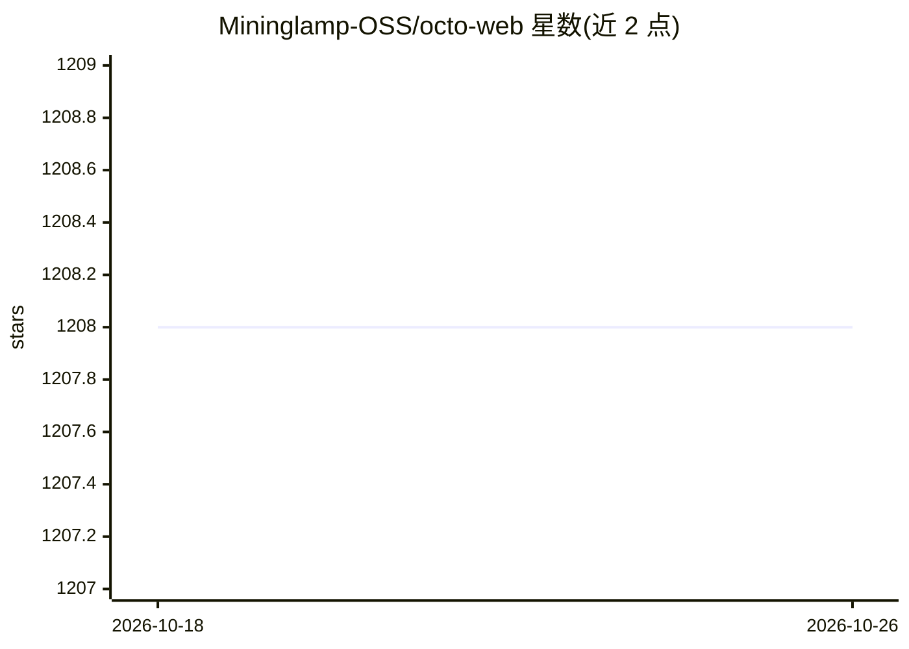

# Mininglamp-OSS/octo-web

⭐ 1,208 · TypeScript · Apache-2.0 · 推送 2026-10-20 · [GitHub](https://github.com/Mininglamp-OSS/octo-web) · [官网](https://github.com/Mininglamp-OSS) · 组织维护 · 中文 README

**OCTO 人×AI agent 协作平台的 Web/桌面客户端**

OCTO 消息平台的 TypeScript/React 前端，同一 src/ 代码同时产出浏览器构建与 Electron 打包的 PC 客户端。通过 REST + WebSocket 连接 octo-server，提供聊天、频道、组织与设置页面；针对 AI agent 对话提供流式回复、工具调用内联预览、agent/人类身份标识等界面元素。自带英文与简体中文双语。需自行 clone 源码并用 pnpm 运行，浏览器构建默认依赖本地 8080 的 octo-server 实例。

## 筛选速览

| 维度 | 判定 | 备注 |
|---|---|---|
| AI 角色 | `ai-enhanced` | 去掉 AI 部分产品仍成立 |
| 许可风险 | `permissive` | Apache-2.0 |
| 部署形态 | `library` | 以包/库形式分发 |
| 模型依赖 | — | README 未给出锁定关系 |
| 硬件要求 | — | 无带数字的原话,不猜 |
| 安装摩擦 | `low` | 无编译、无系统依赖或容器化 |
| 成熟度 | — | 结构信号不足 |

## 能力要点

- 一套 React 代码同时构建浏览器与 Electron 桌面客户端
- AI agent 对话界面：流式回复、内联工具调用预览、身份标识
- 英文与简体中文双语内置，i18n 键由 CI 强制
- PC 端可打包 macOS / Windows / Linux 分发包

## 适用场景

- 为自部署的 OCTO/octo-server 提供网页聊天入口
- 在 PC 上以 Electron 客户端使用 OCTO 消息平台
- 与团队及 AI agent（Lobster）在同一消息工作区协作

## 场景标签

`聊天机器人` · 领域:对话与助手

## 证据(README 行号)

> L19: > **Web & PC (Electron) client** for the OCTO messaging platform — one React codebase, two shipped surfaces.
> L29: - **Lobster-ready UI.** First-class surfaces for AI agent conversations: streaming replies, typing indicator, inlin
> L4:  OCTO — the open workplace built for humans × AI agents.

## 星数曲线

2026-10-18 1,208 → 2026-10-26 1,208（+0）

---
*卡片 v1 · prompt 1.4 · 生成 2026-10-21 · 置信度 low · 依据 README sha `184657dca3e0` · [字段定义](../../DATASET.md)*
