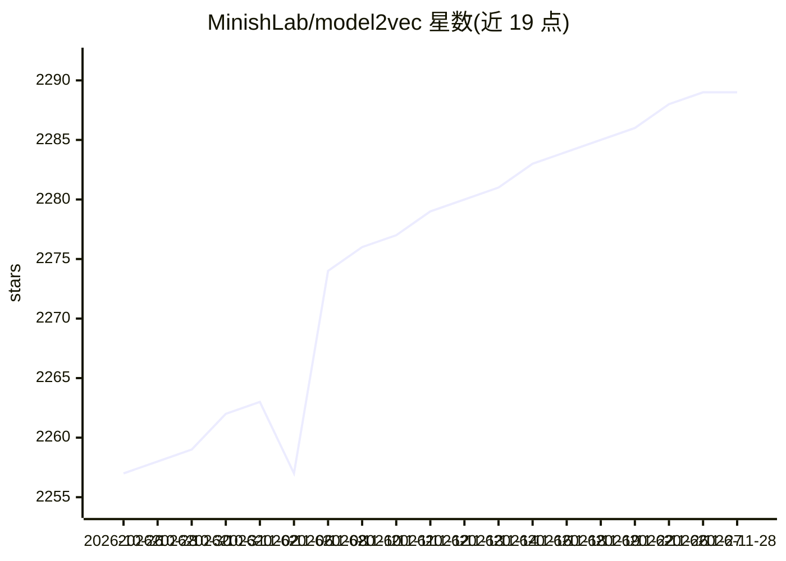

# MinishLab/model2vec

⭐ 2,289 · Python · MIT · 推送 2026-11-27 · [GitHub](https://github.com/MinishLab/model2vec) · [官网](https://minish.ai/packages/model2vec/introduction) · 组织维护

**将 Sentence Transformer 蒸馏为小型快速静态嵌入模型的技术库**

Model2Vec 提供 Python 库，将任意 sentence transformer 转换为小型快速静态嵌入模型：体积最多缩小 50 倍，CPU 推理速度提升至 30000 倍。支持三种用法：直接从 HuggingFace hub 加载预训练模型生成嵌入；无需数据集即可在 CPU 上约 30 秒完成蒸馏；对蒸馏或预训练模型微调用于分类、相似度、回归等任务且运行时不依赖 torch。基础包主要依赖仅 numpy，另提供 Rust 后端。面向需要生成文本嵌入的开发者。

## 筛选速览

| 维度 | 判定 | 备注 |
|---|---|---|
| AI 角色 | `ai-native` | 本体是模型或模型工具 |
| 许可风险 | `permissive` | MIT |
| 部署形态 | `library` | 以包/库形式分发 |
| 模型依赖 | — | README 未给出锁定关系 |
| 硬件要求 | — | 无带数字的原话,不猜 |
| 安装摩擦 | `low` | 无编译、无系统依赖或容器化 |
| 成熟度 | — | 结构信号不足 |

## 能力要点

- 无需数据集、CPU 上约 30 秒完成模型蒸馏
- 基础包主要依赖仅 numpy，轻量安装
- 微调后可在无 torch 环境下运行
- 与 Sentence Transformers、LangChain 等库集成

## 适用场景

- 为文本分类、聚类、检索任务生成嵌入
- 构建 RAG 系统的向量化环节
- 在资源受限的 CPU 环境运行嵌入推理
- 从自有 Sentence Transformer 蒸馏小型嵌入模型

## 场景标签

`语义搜索` `微调` `模型量化` · 领域:知识与检索

## 证据(README 行号)

> L21: Model2Vec is a technique to turn any sentence transformer into a small, fast static embedding model. Model2Vec redu
> L31: You can start using Model2Vec by loading one of our flagship models from the HuggingFace hub. These models are pre-
> L76: - **Fast, Dataset-free Distillation**: distill your own model in 30 seconds on a CPU, without a dataset.

## 星数曲线

2026-10-26 2,257 → 2026-11-28 2,289（+32）

---
*卡片 v1 · prompt 1.4 · 生成 2026-11-28 · 置信度 high · 依据 README sha `8676df2e5978` · [字段定义](../../DATASET.md)*
