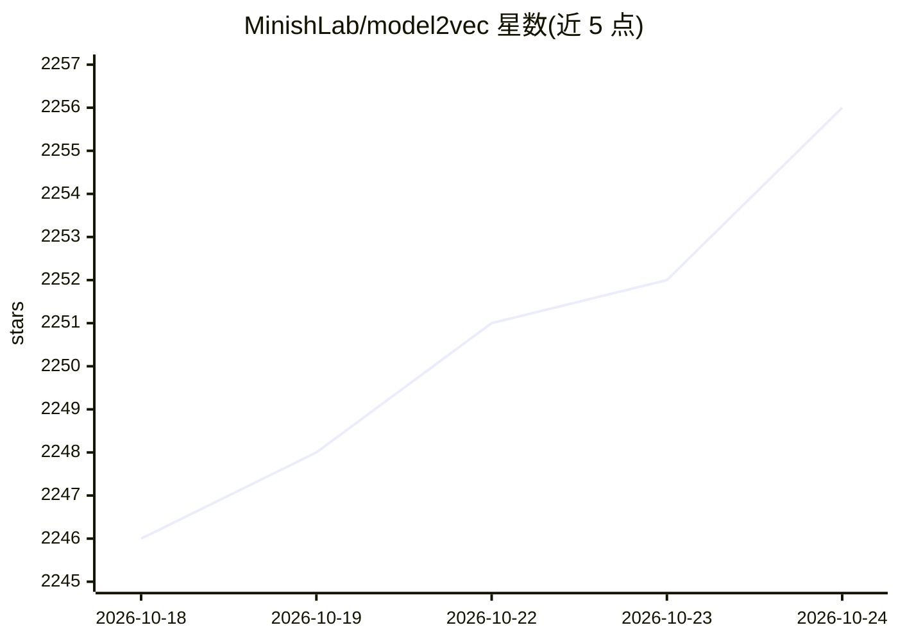

# MinishLab/model2vec

⭐ 2,257 · Python · MIT · 推送 2026-10-19 · [GitHub](https://github.com/MinishLab/model2vec) · [官网](https://minish.ai/packages/model2vec/introduction) · 组织维护

**把 Sentence Transformer 蒸馏成小型快速静态嵌入模型的 Python 库**

Model2Vec 提供一种将任意 sentence transformer 转换为小型静态嵌入模型的技术：将词表前向传播过原模型得到 token 静态嵌入并做后处理，模型体积最多缩小 50 倍，CPU 推理速度最多提升 500 倍。基础包仅以 numpy 为主要依赖，可在 CPU 上约 30 秒无数据集蒸馏自有模型，并支持分类/相似度/回归微调。提供 potion 系列 HuggingFace 预训练模型，可直接用于分类、检索、聚类与 RAG；已集成进 Sentence Transformers 与 LangChain。MIT 许可。

## 筛选速览

| 维度 | 判定 | 备注 |
|---|---|---|
| AI 角色 | `ai-native` | 本体是模型或模型工具 |
| 许可风险 | `permissive` | MIT |
| 部署形态 | `library` | 以包/库形式分发 |
| 模型依赖 | — | README 未给出锁定关系 |
| 硬件要求 | — | 无带数字的原话,不猜 |
| 安装摩擦 | `low` | 无编译、无系统依赖或容器化 |
| 成熟度 | — | 结构信号不足 |

## 能力要点

- 将 sentence transformer 蒸馏为静态嵌入，体积最多缩 50 倍、速度最多提 500 倍
- 基础包主要依赖仅 numpy，微调后可脱离 torch 运行
- CPU 上约 30 秒完成无数据集蒸馏
- 提供 potion 系列预训练模型（8M–128M，含多语与代码检索）

## 适用场景

- 在 CPU 或边缘环境快速生成文本嵌入做检索/聚类/RAG
- 把现有 bge 等 sentence transformer 压缩成小模型部署
- 对静态嵌入模型按自有任务微调

## 场景标签

`模型量化` · 领域:训练与推理

## 证据(README 行号)

> L21: Model2Vec is a technique to turn any sentence transformer into a small, fast static embedding model. Model2Vec redu
> L31: You can start using Model2Vec by loading one of our flagship models from the HuggingFace hub. These models are pre-
> L85: The core idea is to forward pass a vocabulary through a sentence transformer model, creating static embeddings for 

## 星数曲线

2026-10-18 2,246 → 2026-10-24 2,256（+10）

---
*卡片 v1 · prompt 1.4 · 生成 2026-10-21 · 置信度 high · 依据 README sha `80be046598be` · [字段定义](../../DATASET.md)*
