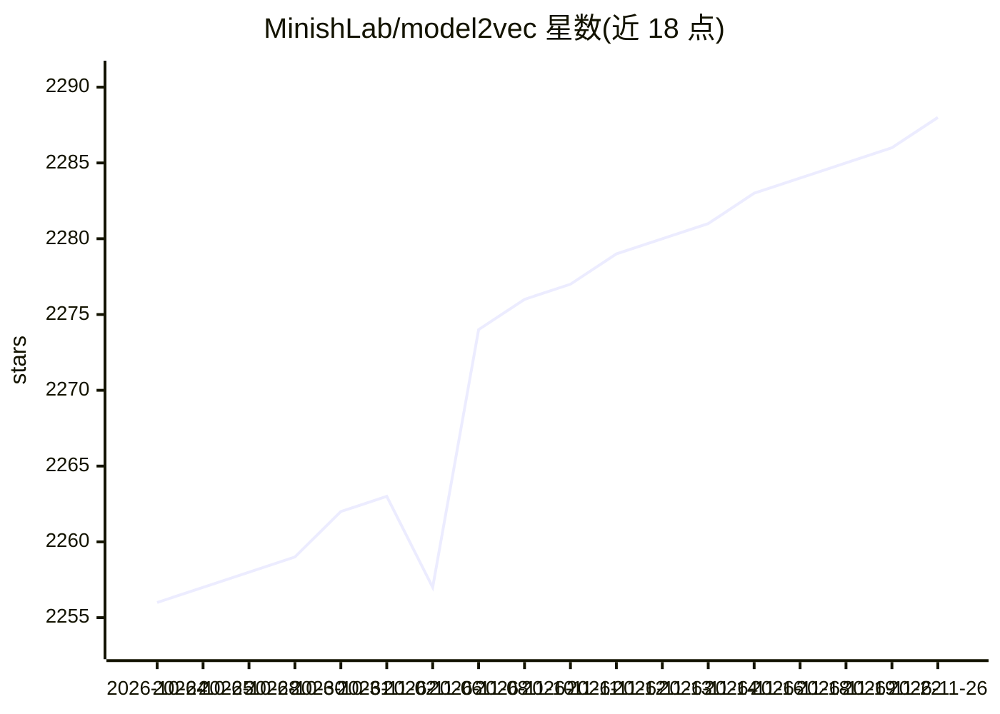

# MinishLab/model2vec

⭐ 2,288 · Python · MIT · 推送 2026-11-25 · [GitHub](https://github.com/MinishLab/model2vec) · [官网](https://minish.ai/packages/model2vec/introduction) · 组织维护

**把 sentence transformer 蒸馏成小型快速静态嵌入模型的工具库**

Model2Vec 提供将任意 Sentence Transformer 转换为小型静态嵌入模型的技术：模型体积最多缩小 50 倍，CPU 推理速度大幅提升。核心机制是让词表通过句子 Transformer 前向传播得到 token 静态嵌入，再经后处理步骤生成模型；蒸馏无需数据集，仅需词表与模型，并支持对蒸馏或预训练模型做分类、相似度、回归等任务的微调。基础包仅依赖 numpy，模型可从 HuggingFace hub 加载与分享。适用于文本分类、检索、聚类、RAG 等任务。

## 筛选速览

| 维度 | 判定 | 备注 |
|---|---|---|
| AI 角色 | `ai-native` | 本体是模型或模型工具 |
| 许可风险 | `permissive` | MIT |
| 部署形态 | `library` | 以包/库形式分发 |
| 模型依赖 | — | README 未给出锁定关系 |
| 硬件要求 | — | 无带数字的原话,不猜 |
| 安装摩擦 | `low` | 无编译、无系统依赖或容器化 |
| 成熟度 | — | 结构信号不足 |

## 能力要点

- 无需数据集即可在 CPU 上约 30 秒蒸馏自有模型
- 基础包主要依赖仅 numpy，微调后可脱离 torch 运行
- 提供预训练模型（通用/多语言/代码），最小约 8 MB
- 已集成进 Sentence Transformers 与 LangChain 等库

## 适用场景

- 为文本分类、检索、聚类任务生成静态嵌入
- 为 RAG 系统构建轻量嵌入后端
- 从自有 Sentence Transformer 蒸馏部署友好模型
- 在 CPU 环境下运行嵌入推理

## 场景标签

`微调` `语义搜索` · 领域:知识与检索

## 证据(README 行号)

> L21: Model2Vec is a technique to turn any sentence transformer into a small, fast static embedding model. Model2Vec redu
> L83: Model2vec creates a small, fast, and powerful model that outperforms other static embedding models by a large margi

## 星数曲线

2026-10-24 2,256 → 2026-11-26 2,288（+32）

---
*卡片 v1 · prompt 1.4 · 生成 2026-11-26 · 置信度 high · 依据 README sha `a5fbc907b0a6` · [字段定义](../../DATASET.md)*
